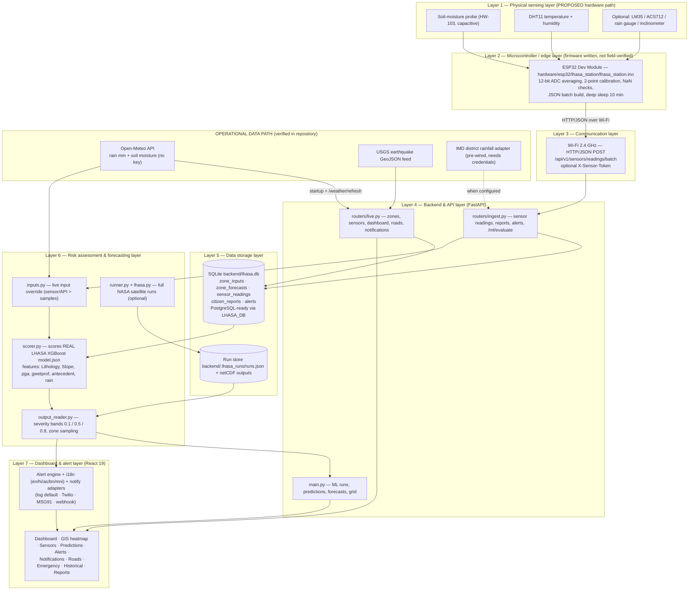
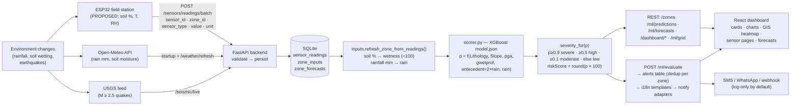

# AI-Based Early Warning and Landslide Risk Monitoring System

## IoT Laboratory Project Report

**Report title:** IoT Laboratory Project Report — IoT-Based Landslide Risk Monitoring and Early Warning System

| Field | Value |
|---|---|
| Project title | AI-Based Early Warning and Landslide Risk Monitoring System |
| Report type | Undergraduate IoT Laboratory / Project Report |
| Student name | *(Placeholder — to be filled)* |
| Enrollment number | *(Placeholder — to be filled)* |
| Institution / Department | *(Placeholder — to be filled)* |
| Faculty / Guide | *(Placeholder — to be filled)* |
| Date of submission | *(Placeholder — to be filled)* |

> **Note on authorship fields.** No student, faculty or institution names are asserted in this report. The placeholders above must be completed by the submitting team.

---

## Abstract

Landslides are among the most destructive rain-triggered natural hazards in mountainous regions, and India's Himalayan belt and North Eastern Region are among the most landslide-prone areas in the world. Timely, continuous observation of rainfall and soil conditions is the foundation of any early warning system, yet conventional monitoring relies on sparse manual measurements and delayed reporting. This project implements an **AI-based landslide risk monitoring and early-warning platform** that combines (a) NASA's **LHASA 2.1.1** machine-learning model (*Landslide Hazard Assessment for Situational Awareness*), (b) a **FastAPI backend** that ingests live environmental data and persists it in a SQL database, and (c) a **React-based monitoring dashboard** covering risk zones, GIS mapping, sensors, alerts, forecasts, citizen reports and emergency response across 27 monitoring zones in India's hazard belt.

From an Internet of Things (IoT) perspective, the system is designed as a complete sensor-to-dashboard data pipeline. Environmental data enters the platform through three routes: (1) free live web APIs — Open-Meteo weather (rainfall and soil moisture) and the USGS earthquake feed — which are **implemented and verified working** in this repository; (2) a district rainfall adapter for India's Meteorological Department (IMD), which is **pre-wired but requires external credentials**; and (3) a **physical IoT field station** based on the **ESP32** microcontroller with a capacitive soil-moisture sensor (HW-103) and a DHT11 temperature/humidity sensor, which pushes JSON telemetry batches over Wi-Fi to the backend endpoint `POST /api/v1/sensors/readings/batch`. The ESP32 firmware, the ingestion API, the sensor-to-model mapping and the wiring/power design are **fully implemented in code**, but **no evidence of a physically operational sensor station exists in the repository** (the telemetry table is empty); the hardware path is therefore documented in this report as a *designed and coded, but not yet field-verified* prototype.

Sensor values, once ingested, override sample inputs inside the risk scorer, which evaluates the real trained XGBoost model (`LHASA/model.json`, features: lithology, slope, peak-ground-acceleration context, soil wetness, antecedent rainfall and current rainfall) for every zone. Risk scores are classified into four severity bands (low, moderate, high, severe), visualised on the dashboard and GIS heatmap, and can be converted into multilingual alerts (English, Hindi, Assamese, Bengali, Meiteilon) with pluggable SMS/webhook delivery adapters. Repository evidence (a populated SQLite database) confirms that live Open-Meteo ingestion, forecast storage and ML-generated alerts have all executed successfully, while physical sensor telemetry, real NASA satellite runs and out-of-band alert delivery remain untested or pending. This report documents the architecture, hardware design, firmware, circuit connections, data flow, testing plan, performance methodology, sustainability mapping and future extension path of the system.

**Keywords:** Internet of Things, landslide early warning, ESP32, soil moisture sensing, rainfall monitoring, NASA LHASA, XGBoost, FastAPI, real-time dashboard, environmental monitoring, disaster risk reduction.

---

## Table of Contents

- [1. Project Summary](#1-project-summary)
  - [1.1 Introduction and Background](#11-introduction-and-background)
  - [1.2 Statement of the Problem](#12-statement-of-the-problem)
  - [1.3 Objectives](#13-objectives)
  - [1.4 Technology / Research Gap](#14-technology--research-gap)
  - [1.5 Deliverables](#15-deliverables)
  - [1.6 Resources and Budget](#16-resources-and-budget)
  - [1.7 Project Plan with Milestones](#17-project-plan-with-milestones)
  - [1.8 Software Requirement Specification (SRS)](#18-software-requirement-specification-srs)
  - [1.9 Risk Mitigation](#19-risk-mitigation)
- [2. Implementation Details](#2-implementation-details)
  - [2.1 System Architecture](#21-system-architecture)
  - [2.2 Hardware Components with Description](#22-hardware-components-with-description)
  - [2.3 Working Mechanism](#23-working-mechanism)
  - [2.4 Circuit Connections](#24-circuit-connections)
  - [2.5 Code](#25-code)
- [3. Comparative System Analysis](#3-comparative-system-analysis)
- [4. Simulation and Prototyping](#4-simulation-and-prototyping)
  - [4.1 System Simulation](#41-system-simulation)
  - [4.2 Physical Prototype](#42-physical-prototype)
- [5. Result and Discussion](#5-result-and-discussion)
  - [5.1 Functional Testing Results](#51-functional-testing-results)
  - [5.2 Dashboard and Monitoring](#52-dashboard-and-monitoring)
  - [5.3 Performance Analysis](#53-performance-analysis)
- [6. Mapping with Sustainability Goals](#6-mapping-with-sustainability-goals)
- [7. Conclusion](#7-conclusion)
- [8. Future Scope](#8-future-scope)
- [9. References](#9-references)

---

## 1. Project Summary

### 1.1 Introduction and Background

A **landslide** is the downslope movement of rock, debris or earth under the influence of gravity. In the Indian context, landslides occur predominantly in the Himalayan belt (Jammu & Kashmir, Himachal Pradesh, Uttarakhand, Sikkim and the North Eastern States) and along the Western Ghats, almost always triggered or reactivated by **intense or prolonged rainfall**, sometimes combined with seismic activity, snowmelt, road cutting and deforestation [3][5]. The physical chain is well established in the scientific literature: rainfall infiltrates the soil, increases pore-water pressure and soil weight, reduces the shear strength of the slope material, and when a critical saturation threshold is exceeded the slope fails. Because that threshold depends on **antecedent rainfall** (how wet the soil already was) as much as on the current storm, continuous measurement of *rainfall* and *soil moisture* is far more informative than occasional point observations [2][3].

The project described in this report is an **AI-based early warning and landslide risk monitoring system** for India's hazard belt. Its core is NASA's **LHASA 2.1.1** model [1][2], an XGBoost regressor that estimates the daily probability of a rainfall-triggered landslide (`p_landslide`, 0–1) at ~1 km grid resolution from six input features: **lithology** (geological class), **slope** (degrees), **pga** (peak ground acceleration context — seismic preconditioning), **gwetprof** (soil profile wetness, 0–1), **antecedent** (rainfall accumulated over the previous ~2 days, mm) and **rain** (current-day rainfall, mm, normalised inside the pipeline by the regional 99th-percentile rainfall map). Three of these features — soil wetness, antecedent rainfall and current rainfall — are *dynamic environmental variables*, exactly the quantities an **IoT sensor network** is designed to measure. This is what makes the project an IoT project rather than only a web application: the quality of every risk score depends on the freshness and accuracy of ground measurements.

The platform implements an end-to-end IoT-style data pipeline:

1. **Data acquisition** — live weather APIs (Open-Meteo for rainfall and soil moisture; USGS for seismicity), an IMD district-rainfall adapter (pre-wired), and an **ESP32 field station** (firmware in `hardware/esp32/lhasa_station/lhasa_station.ino`) that reads a capacitive soil-moisture probe and a DHT11 temperature/humidity sensor.
2. **Transmission** — Wi-Fi (802.11 b/g/n, 2.4 GHz) with HTTP/JSON telemetry batches to the backend, optionally protected by a shared-secret token (`X-Sensor-Token`).
3. **Backend processing and storage** — a FastAPI server (`backend/app/`) validates payloads and persists them with SQLAlchemy into a SQLite database (tables `sensor_readings`, `zone_inputs`, `zone_forecasts`, `alerts`, `citizen_reports`), upgradeable to PostgreSQL through the `LHASA_DB` environment variable.
4. **Risk assessment** — the scorer evaluates the *real trained model* (`LHASA/model.json`) per zone; stored sensor/weather values automatically **override** the demo sample inputs, so the risk score moves with actual ground conditions.
5. **Visualisation and alerting** — a React 19 dashboard (zones, GIS heatmap, sensors, forecasts, alerts, notifications, roads, emergency zones, historical events, citizen reports) plus an alert engine that converts severe/high predictions into multilingual alert records with pluggable SMS/WhatsApp/webhook delivery adapters.

**What is operational today, versus proposed.** This distinction is maintained rigorously throughout the report:

| Capability | Status in this repository |
|---|---|
| React dashboard (14 pages) with live API integration | Implemented and exercised (API log shows successful requests) |
| FastAPI backend, all REST endpoints | Implemented |
| Real LHASA XGBoost model scoring per zone | Implemented (`backend/app/scorer.py`) |
| Open-Meteo live weather ingest (rain + soil wetness) per zone | **Implemented and verified** — 27 `zone_inputs` rows and 81 `zone_forecasts` rows exist in `backend/lhasa.db`, source `open-meteo` |
| ML alert generation (`POST /api/v1/ml/evaluate`) | **Implemented and verified** — 11 alert rows exist in the database, source "ML Prediction Service (LHASA)" |
| USGS live earthquake feed on the GIS map | Implemented (network-dependent) |
| Sensor ingestion API (single + batch, optional token auth) | Implemented in code; **never exercised with real data** (the `sensor_readings` table is empty) |
| ESP32 firmware (soil moisture + DHT11, deep sleep, HTTP batch push) | Written and documented; **no evidence of a flashed, field-operating station** |
| Full NASA satellite LHASA runs (IMERG/SMAP/GEOS) | Infrastructure implemented (runner, output reader); static rasters present (~1.5 GB in `LHASA/static/`); **no completed run directory exists** — the system currently serves the demo/sensor scoring path |
| IMD district rainfall adapter | Pre-wired (`backend/app/providers/imd.py`); needs an IMD endpoint/key or a local JSON feed |
| SMS/WhatsApp delivery (Twilio / MSG91 / webhook) | Adapters implemented; **not configured** — default channel is log-only |

### 1.2 Statement of the Problem

Conventional landslide monitoring in India relies on a combination of manual field inspection, rainfall stations spaced far apart, post-disaster reporting and anecdotal community observation. Its limitations are well documented in practice:

- **Delayed observation.** A slope that is saturating during a night-time cloudburst may not be observed until morning — or until it fails. Landslides such as the 2013 Kedarnath disaster and the 2024 Wayanad Chooralmala–Mundakkai tragedy unfolded within hours, faster than manual observation cycles can respond [5].
- **Limited spatial coverage.** One district may have a single rain gauge tens of kilometres from the affected slope; soil moisture — the variable that actually governs slope strength — is rarely measured at all.
- **Manual, intermittent measurement.** Periodic field measurements cannot capture the antecedent wetness build-up that precedes failure; data recorded on paper or in isolated logbooks never reaches decision makers in time.
- **Fragmented data.** Weather data, seismic data, road blockage information and citizen observations usually live in separate offices and formats, preventing a unified risk picture.
- **Weak last-mile communication.** Even where warnings exist, reaching a remote hill community in a local language, on a low-bandwidth channel, remains difficult.

The specific problem addressed by this project is the **absence of a continuous, automated, data-driven loop** connecting environmental measurements to a validated landslide probability and from there to an actionable warning. The system's IoT-oriented architecture addresses each limitation: microcontroller-based stations measure soil and climate conditions *in situ* at configurable intervals; readings are transmitted over Wi-Fi as structured JSON; the backend validates, stores and folds them into a scientific model; and the dashboard plus alert engine turn the result into zone-level risk classes, maps and notifications that a district officer can act on. The system deliberately degrades gracefully — if a station goes silent, its zone falls back to live Open-Meteo estimates and then to calibrated sample inputs — so no single link in the chain can disable monitoring altogether.

*No claim of measured accuracy, field deployment or disaster-prevention impact is made; the system has not been validated against a controlled field dataset, and this report states its evidence limits explicitly.*

### 1.3 Objectives

The objectives of the project, labelled by their implementation status, are:

**Implemented objectives (software):**

1. **O1 — Environmental parameter monitoring:** continuously monitor rainfall and soil wetness for 27 landslide-prone zones (`rz-001`…`rz-027`) across the Himalaya, North East India and the Western Ghats using live Open-Meteo data, with temperature/humidity/thresholds modelled for sensor stations.
2. **O2 — Backend processing and storage:** implement a FastAPI backend that validates and persists zone inputs, forecasts, sensor readings, citizen reports and alerts in a relational schema (SQLite by default, PostgreSQL-ready).
3. **O3 — Landslide risk assessment:** score the real NASA LHASA XGBoost model per zone from six features, with live data taking precedence over sample inputs, and classify risk into four severity bands.
4. **O4 — Real-time dashboard monitoring:** deliver a responsive web dashboard (zones, GIS heatmap, sensors, predictions, forecasts, alerts, notifications, roads, emergency zones, historical events, reports) fed by REST endpoints with graceful fallbacks.
5. **O5 — Early warning and alert generation:** convert severe/high model output into persistent alert records, deduplicated per zone, translated into five languages, with pluggable multi-channel delivery adapters.
6. **O6 — Live data integration:** integrate external live sources — Open-Meteo weather, USGS seismicity — and pre-wire an IMD district-rainfall adapter.

**Objectives that depend on future hardware integration (proposed / coded but not field-verified):**

7. **O7 — IoT-based sensor data acquisition:** acquire ground-truth soil moisture and micro-climate data with an ESP32-based field station (firmware written; hardware not yet demonstrated in this repository).
8. **O8 — Reliable transmission of sensor readings:** transmit readings as validated JSON telemetry over Wi-Fi with optional shared-secret authentication and deep-sleep power management (implemented in firmware and backend; untested end-to-end).
9. **O9 — Hardware–software integration:** prove the full loop — sensor reading → HTTP batch push → database row → zone input override → changed risk score → dashboard update — on physical hardware.
10. **O10 — System testing and performance evaluation:** execute the test plan of §5.1 and the measurement methodology of §5.3 on a bench prototype and record real results.

### 1.4 Technology / Research Gap

Conventional monitoring approaches deliver **spatially sparse, temporally intermittent** data and typically stop at data collection: a rain-gauge network records rainfall, but the transformation of rainfall into a location-specific probability and a warning remains a manual expert judgement. Satellite-only systems such as the global LHASA product improve coverage but at ~1 km resolution and with a latency of the satellite product itself; they also cannot see *in-situ* soil conditions on a specific vulnerable slope [2][3]. Standalone sensor logger systems, in turn, often collect good local data but lack a scientific model, persistence and a decision-facing interface.

The opportunities that this project's architecture exploits are:

- **Continuous sensing at the point of risk.** Soil moisture is LHASA's `gwetprof` input; a single calibrated probe on the critical slope changes the zone's probability more than any other live variable (as the project's own integration guide documents in `doc/IOT_INTEGRATION.md`).
- **Model-in-the-loop ingestion.** Unlike a dashboard that merely displays sensor values, this backend feeds sensor values *into a trained model* and re-scores risk on demand.
- **Graceful multi-source fallback.** Ground sensors → live weather API → calibrated samples. This is a deliberate IoT reliability pattern (degraded modes) rarely implemented in prototype-stage systems.
- **Zero-cost live operation.** Open-Meteo and the USGS feed require no API key or account, so the entire monitoring loop runs live "out of the box"; NASA satellite runs are optional enhancements.
- **Last-mile features.** Multilingual alert templates (English/Hindi/Assamese/Bengali/Meiteilon), offline citizen-report queueing (IndexedDB), and log-first notification adapters address deployment realities in the target region.

Compared to these opportunities, the project's current gaps are equally concrete: no physical station has been validated in the repository; IMD integration needs official credentials; alert delivery has no subscriber directory; and model probabilities have not been calibrated against a local landslide inventory. These gaps are tracked in the risk table (§1.9) and the future scope (§8). No claim of novelty over all existing systems is made; the contribution is an integrated, evidence-documented implementation of these patterns on top of a published scientific model.

### 1.5 Deliverables

**Completed deliverables (verified in the repository):**

| # | Deliverable | Location / evidence |
|---|---|---|
| D1 | React monitoring dashboard (14 pages: Landing, Login, Dashboard, GIS, Analytics, Predictions, Reports, Report-Submit, Roads, Alerts, Notifications, Emergency, Sensors, Historical, Settings) | `frontend/src/pages/` |
| D2 | Frontend service layer with typed API client and mock-fallback degradation | `frontend/src/services/` (`api.ts`, `dashboardService.ts`, `mlService.ts`, `sensorService.ts`, …) |
| D3 | FastAPI backend with 30+ REST endpoints (ML runs, predictions, forecasts, recommendations, zones, sensors, readings, alerts, reports, dashboard analytics, roads, historical, emergency, notifications, weather refresh, seismic, heatmap grid, health) | `backend/app/main.py`, `backend/app/routers/ingest.py`, `backend/app/routers/live.py` |
| D4 | SQL persistence layer (SQLAlchemy 2.0; tables `zone_inputs`, `zone_forecasts`, `sensor_readings`, `citizen_reports`, `alerts`) | `backend/app/models.py`, `backend/app/db.py`, populated `backend/lhasa.db` |
| D5 | Risk assessment engine scoring the real LHASA XGBoost model with live-input override logic | `backend/app/scorer.py`, `backend/app/inputs.py` |
| D6 | NASA LHASA run orchestration (background subprocess runs, run store, netCDF output reader, zone sampling) | `backend/app/runner.py`, `backend/app/output_reader.py`, `LHASA/lhasa.py` |
| D7 | Live data providers: Open-Meteo weather + 3-day forecast, USGS seismic feed, IMD adapter, notification adapters | `backend/app/providers/` |
| D8 | Alert engine with deduplication, 5-language templates and delivery fan-out | `POST /api/v1/ml/evaluate`, `backend/app/i18n.py`, `backend/app/providers/notify.py` |
| D9 | Offline citizen-report queue (IndexedDB) with flush-on-reconnect | `frontend/src/utils/offlineQueue.ts` |
| D10 | IoT integration guide, wiring tables, power budget, troubleshooting matrix | `doc/IOT_INTEGRATION.md` |
| D11 | ESP32 field-station firmware (soil moisture + DHT11, optional LM35/ACS712, deep sleep, HTTP batch telemetry, token auth) | `hardware/esp32/lhasa_station/lhasa_station.ino` |
| D12 | Architecture documentation (high-level design diagram, live-data API catalogue, real-data guide, adaptation plan) | `doc/HLD.drawio(.png)`, `doc/INDIA_LIVE_DATA_APIS.md`, `doc/REAL_DATA_GUIDE.md`, `doc/NER_ADAPTATION_PLAN.md` |
| D13 | Static terrain rasters for live NASA runs (Lithology, Slope, pga, mask, p99, p99geos ≈ 1.5 GB) | `LHASA/static/` |

**Proposed / pending deliverables:**

| # | Deliverable | Status |
|---|---|---|
| P1 | Assembled and field-tested physical sensor node (ESP32 + probes + enclosure + power) | Designed (§2.4, §4.2); not built in this repository |
| P2 | Circuit schematic (EDA files) and PCB | Text reference design only (`doc/IOT_INTEGRATION.md` §3.3) |
| P3 | Executed test report with measured results (§5.1, §5.3) | Test *plan* provided; results pending |
| P4 | End-to-end hardware→dashboard validation evidence (serial logs, screenshots, DB rows from a physical station) | Pending |
| P5 | IMD live credentials and verified district-rainfall ingestion | Adapter implemented; credentials pending |
| P6 | Real SMS/WhatsApp delivery configuration and subscriber directory | Adapters implemented; configuration pending |

### 1.6 Resources and Budget

#### 1.6.1 Software and cloud resources

| Resource | Purpose | Cost basis |
|---|---|---|
| Python 3.12 + FastAPI + Uvicorn | Backend API server [7] | Free, open source |
| SQLAlchemy 2.0 + SQLite (default) / PostgreSQL | Persistence [11] | Free, open source |
| XGBoost + NumPy | Model scoring [12] | Free, open source |
| NASA LHASA 2.1.1 (model + pipeline, NASA Open Source Agreement) | Landslide probability model [1] | Free (registration-free code; Earthdata account free for live data [15]) |
| Node.js + Vite + React 19 + TypeScript | Frontend build/dev [8][18] | Free, open source |
| Tailwind CSS, Leaflet / react-leaflet, Recharts, Zustand, TanStack Query | UI, maps, charts, state [13] | Free, open source |
| Arduino IDE 2.x + ESP32 Arduino core + DHT library + ArduinoJson | Firmware development [6][16][17] | Free, open source |
| Open-Meteo API | Live rainfall / soil moisture / forecasts [9] | Free, no API key |
| USGS earthquake GeoJSON feed | Live seismicity [10] | Free, no API key |
| IMD / MOSDAC APIs | Official district rainfall (optional, pre-wired) [19] | Free subject to registration |
| Twilio / MSG91 / generic webhook | Real alert delivery (optional) [21] | Usage-dependent paid services (not configured) |

*No paid cloud service is required to run the complete system on a local network; deployment hosting (e.g. a small VM or container platform) would be an usage-dependent cost outside the scope of this repository.*

#### 1.6.2 Hardware components — already available to the team (as documented in `doc/IOT_INTEGRATION.md`)

The project's IoT integration guide performs a component-relevance analysis for a hardware kit, so the following components are treated as *available to the team*. Prices are **approximate Indian-market estimates (INR) for 2026 and must not be read as quotations** — actual prices vary by vendor.

| Component | Role in project | Approx. cost (INR) |
|---|---|---|
| ESP32 Dev Module (Wi-Fi microcontroller) | Reads sensors, pushes telemetry, deep-sleep power management | ₹350 – ₹500 |
| HW-103 capacitive soil-moisture sensor | Primary sensor: soil wetness → LHASA `gwetprof` input | ₹60 – ₹120 |
| DHT11 temperature + humidity sensor | Ambient context readings on the Sensors page | ₹50 – ₹100 |
| LM35 analog temperature sensor | Redundant/backup temperature channel (optional flag `USE_LM35`) | ₹20 – ₹50 |
| ACS712 current sensor | Optional: cabinet mains-health monitoring (flag `USE_ACS712`) | ₹150 – ₹250 |
| pH sensor kit | **Not used** — excluded deliberately (no landslide physics) | — |
| USB cable, breadboard, jumper wires | Bench assembly and flashing | ₹100 – ₹250 |
| 5 V / 1 A USB power supply | Bench power (ESP32 Wi-Fi peak current) | ₹100 – ₹200 |

#### 1.6.3 Hardware components — proposed for the field prototype

| Component | Purpose | Approx. cost (INR) |
|---|---|---|
| Tipping-bucket rain gauge (0.2 mm/reed switch) | Real rainfall (mm) — the second live LHASA input | ₹800 – ₹2,000 |
| MEMS inclinometer (MPU-6050 class) | Direct slope-tilt/creep precursor (I2C) | ₹100 – ₹250 |
| DS3231 RTC module | Accurate timestamps across deep-sleep cycles | ₹150 – ₹300 |
| microSD module | Offline buffering of readings during network loss | ₹100 – ₹200 |
| Solar kit: 6 V / 2 W panel + TP4056 + 18650 cell + AMS1117-3.3 | Year-round unattended power | ₹600 – ₹1,200 |
| INA219 | Battery voltage/current telemetry (station health) | ₹200 – ₹350 |
| Weatherproof enclosure (IP65-class) + vented radiation shield | Environmental protection of electronics | ₹500 – ₹1,500 |
| PVC mounting pole, earthing, silicone-sealed glands | Field mounting | ₹300 – ₹800 |
| **Subtotal (proposed prototype, one node)** | | **≈ ₹2,800 – ₹6,600 (approximate)** |

#### 1.6.4 Optional components

| Component | Purpose | Approx. cost (INR) |
|---|---|---|
| LoRa module (Ra-02 / SX1278) pair | Long-range link for sites without Wi-Fi/cellular (gateway posts to API) | ₹350 – ₹600 each |
| Buzzer + LED + transistor | Local evacuation siren on severe alert (future endpoint) | ₹50 – ₹150 |
| External-antenna ESP32 variant | Improved outdoor Wi-Fi range | ₹500 – ₹900 |
| 4G/LTE module (e.g. A7670 class) | Alternative backhaul where no Wi-Fi exists | ₹1,500 – ₹3,000 |

*All prices above are indicative estimates compiled from general online-market ranges; they are not verified vendor quotations and should be re-checked at the time of purchase.*

### 1.7 Project Plan with Milestones

The durations below are **estimates for planning purposes**. Completion status reflects what the repository evidence supports; historical completion *dates* are intentionally not invented. The project's own planning document (`doc/NER_ADAPTATION_PLAN.md`, status note "Phase 0 and Phase 1 done") corroborates the software milestones.

| Milestone | Activities | Expected deliverables | Est. duration | Completion status (per repository evidence) |
|---|---|---|---|---|
| M1 — Requirement analysis | Study landslide problem, LHASA model, target region; fit/gap analysis | `doc/NER_ADAPTATION_PLAN.md`, problem definition | 2 weeks | **Completed** (document exists with fit/gap table) |
| M2 — System design | Layered architecture, zone definition (27 zones), API contract, HLD diagram | `doc/HLD.drawio`, `backend/app/zones.py`, schemas | 2 weeks | **Completed** |
| M3 — Frontend development | 14 dashboard pages, services, charts, GIS map, offline queue | `frontend/` application | 4 weeks | **Completed** |
| M4 — Backend & ML integration | FastAPI endpoints, LHASA runner/scorer, demo mode, output reader | `backend/app/`, `LHASA/` integration | 3 weeks | **Completed** |
| M5 — Real data loop (Phase 1) | SQLite models, sensor/IMD ingestion endpoints, Open-Meteo + USGS providers, auto-alerts, i18n templates | `models.py`, `routers/ingest.py`, `providers/`, `i18n.py` | 3 weeks | **Completed** (DB rows confirm live ingest + alerts) |
| M6 — IoT hardware design | Component relevance analysis, pin map, wiring tables, power budget, firmware | `hardware/esp32/…/lhasa_station.ino`, `doc/IOT_INTEGRATION.md` | 2 weeks | **Completed (design/code)** |
| M7 — Sensor integration & communication | Flash ESP32, bench-test push, verify DB rows, verify zone override, dashboard appearance | Serial logs, DB evidence, screenshots | 1–2 weeks | **Pending** (no hardware evidence in repository) |
| M8 — Dashboard integration & refinement | Live/mock fallback polish, sensor auto-discovery UI, heatmap layer | Working UI pages | 2 weeks | **Completed** |
| M9 — Testing | Execute test plan (§5.1), performance measurement (§5.3) | Test report with actual results | 1–2 weeks | **Plan ready; execution pending** |
| M10 — Report & documentation | This report, wiring guide, API catalogue, future roadmap | `report.md`, `doc/*` | 1–2 weeks | **Completed (this document)** |

### 1.8 Software Requirement Specification (SRS)

#### 1.8.1 Functional requirements

| ID | Requirement | Priority | Implementation status |
|---|---|---|---|
| FR-01 | The system shall acquire environmental data (rainfall mm, soil wetness 0–1) for all 27 monitoring zones | High | **Implemented** — Open-Meteo ingest at startup and via `POST /api/v1/weather/refresh` (verified: 27 `zone_inputs` rows) |
| FR-02 | The system shall accept single and batched sensor telemetry (`sensor_id`, `zone_id`, `sensor_type`, `value`, `unit`, optional `recorded_at`) via HTTP/JSON | High | **Implemented** — `POST /api/v1/sensors/readings` and `/batch` (1–50 readings) |
| FR-03 | The system shall validate sensor payloads (known `zone_id`, typed fields) and report per-row errors without failing the whole batch | High | **Implemented** — batch returns `{ok, stored, errors[]}` |
| FR-04 | The system shall protect the ingest endpoint with an optional shared secret (`X-Sensor-Token` header or `?token=`) | Medium | **Implemented** — enabled by env `SENSOR_INGEST_TOKEN` (untested end-to-end) |
| FR-05 | The system shall convert stored readings into per-zone model inputs (soil % → wetness, rainfall mm → rain) | High | **Implemented** — `inputs.refresh_zone_from_readings()` |
| FR-06 | The system shall store zone inputs, forecasts, readings, reports and alerts in a relational database | High | **Implemented** — SQLAlchemy models; SQLite `backend/lhasa.db` (verified populated) |
| FR-07 | The system shall compute a landslide probability per zone by scoring the trained LHASA XGBoost model | High | **Implemented** — `scorer.py` (real `model.json`) |
| FR-08 | Live sensor/weather values shall take precedence over calibrated sample inputs | High | **Implemented** — `scorer._features_for()` reads `inputs.get_live()` |
| FR-09 | The system shall classify probabilities into low/moderate/high/severe bands and compute risk score and confidence | High | **Implemented** — `output_reader.severity_for()` (thresholds 0.1/0.5/0.9) |
| FR-10 | The system shall provide 24h/48h/72h forecasts with real forecast rainfall where available | Medium | **Implemented** — `zone_forecasts` (verified: 81 rows) merged into forecast records |
| FR-11 | The system shall run the full NASA LHASA pipeline on demand (nowcast + N forecast days over a bounding box) | Medium | **Implemented (infrastructure)** — background runs, run store, netCDF sampling; requires NASA credentials; **no completed run in repo** |
| FR-12 | The system shall raise alerts from severe/high predictions, deduplicated per zone | High | **Implemented and verified** — 11 alert rows, source "ML Prediction Service (LHASA)" |
| FR-13 | Alert content shall be generated in multiple languages (en, hi, as, bn, mni) | Medium | **Implemented** — `i18n.py` templates |
| FR-14 | Alerts shall be dispatched through a configurable channel (log / Twilio / MSG91 / webhook) | Medium | **Implemented (log-only by default)** — external channels not configured |
| FR-15 | The dashboard shall display zones with live risk scores, severity and factors | High | **Implemented** — `GET /api/v1/zones`, Dashboard/GIS pages |
| FR-16 | The dashboard shall show sensor stations, their status and 24 h reading history from stored data only | High | **Implemented** — `/sensors`, `/sensors/{id}/readings`; UI renders an honest empty state when no data |
| FR-17 | New IoT stations shall appear automatically after their first push (auto-discovery) | Medium | **Implemented (code path untested with real data)** — `_discovered_iot_sensors()` |
| FR-18 | The GIS page shall render a model-derived risk heatmap and live USGS earthquakes | Medium | **Implemented** — `GET /api/v1/ml/grid` (XGBoost-scored grid), `GET /api/v1/seismic/live` |
| FR-19 | Citizens shall submit geo-tagged incident reports; offline submissions shall be queued and synced | Medium | **Implemented** — `POST /api/v1/reports` + IndexedDB queue (`citizen_reports` table currently empty) |
| FR-20 | The system shall ingest IMD district rainfall when an endpoint/key or local feed is provided | Medium | **Pre-wired** — `providers/imd.py`; requires configuration |
| FR-21 | The system shall provide dashboard analytics: summary counts, 7-day trends, district risk, severity distribution, rainfall-vs-risk | Medium | **Implemented** (partly derived — see §5.2 disclosure) |
| FR-22 | The system shall present road status, historical events and emergency response zones | Low | **Implemented** (road status is risk-model-derived; historical events are curated records) |
| FR-23 | ESP32 station shall read soil moisture and DHT11, build a JSON batch and POST it, with deep sleep between cycles | High | **Firmware implemented; not verified on hardware** |
| FR-24 | User authentication with roles (admin / disaster officer / citizen) | Low | **Prototype only** — mock login, `ProtectedRoute` is a pass-through |

#### 1.8.2 Non-functional requirements

| ID | Requirement | Approach in this project | Status |
|---|---|---|---|
| NFR-01 | Reliability — no single point of failure disables monitoring | Multi-source fallback chain (sensor → Open-Meteo → sample inputs); delivery failures never break alert creation (`notify.send_alert` never raises) | Implemented (software paths) |
| NFR-02 | Performance — interactive dashboard responses | SQLite + in-memory model booster (thread-safe singleton, `nthread=1`); frontend requests carry a 4 s abort timeout | Implemented; not formally benchmarked (see §5.3) |
| NFR-03 | Security — protection of ingest and data paths | Optional shared-secret ingest token; advisory notes for TLS/VPN deployment; no secrets committed; credentials read from environment variables only | Partial — token implemented; TLS, per-device identity and real auth pending |
| NFR-04 | Scalability — growth to more stations/zones | SQLAlchemy models portable to PostgreSQL (`LHASA_DB`); batch endpoint absorbs multi-sensor wake cycles; guidance states 20–50 stations per single-process setup, beyond which an MQTT→worker queue is recommended | Documented; horizontal scaling not implemented |
| NFR-05 | Maintainability — clear module boundaries | Provider pattern (`providers/`), routers, typed frontend services, extensive inline documentation | Implemented |
| NFR-06 | Usability — accessible to district officers | 14 labelled pages, severity badges, empty/skeleton states, multilingual alert text | Implemented (UI language: English) |
| NFR-07 | Data integrity — valid inputs, no fabricated telemetry | Pydantic validation; range clamps (`wetness` 0–1, `rain ≥ 0`); sensor UI shows "Not reported" instead of guessed battery values; readings charts render only stored measurements | Implemented |
| NFR-08 | Network-failure handling | Firmware retries on next wake cycle when Wi-Fi/HTTP fails; frontend `withFallback()` degradation; browser-side offline report queue flushed on reconnect | Implemented |
| NFR-09 | Power efficiency (IoT node) | ESP32 deep sleep (~10 µA) with 10-minute wake cadence; average current budget ≈ 15–25 mA (see §2.4) | Designed; not measured on hardware |
| NFR-10 | Privacy | Citizen reports store only name/phone optionally; no third-party analytics; data stays in the deployment's own database | Implemented (policy-level) |

### 1.9 Risk Mitigation

| # | Risk | Possible impact | Mitigation strategy (in place or planned) | Status / residual limitation |
|---|---|---|---|---|
| R1 | Sensor failure (probe corrosion, disconnection) | Zone silently loses ground truth | Fallback chain: Open-Meteo live values, then calibrated samples; sensor status shown as offline/warning on the dashboard (3 h recency rule) | Implemented in software; physical probe durability untested |
| R2 | Incorrect or noisy readings | Skewed risk score | Firmware averages 16 ADC samples; soil values clamped 0–100 %; ratiometric two-point calibration (`SOIL_DRY_RAW`/`SOIL_WET_RAW`); wetness clamped 0–1 in backend | Implemented; site-specific calibration still required |
| R3 | Network connectivity loss | Missing telemetry | Deep-sleep retry each wake cycle; zone falls back to weather API; proposed microSD buffering + LoRa bridge for Wi-Fi-less sites | Retry + fallback implemented; offline buffering **proposed** |
| R4 | Power interruption at the station | Station blackout | Deep-sleep duty cycle; solar kit design (panel → TP4056 → 18650 → AMS1117-3.3); optional ACS712 mains-health channel | Designed; not field-tested |
| R5 | Invalid or missing data fields | Broken ingestion | Pydantic schemas (typed fields, batch size 1–50, lat/lon bounds); per-row error reporting in batch responses; NaN guards in scoring | Implemented |
| R6 | External API failure (Open-Meteo, USGS) | Stale inputs | Timeouts (12–15 s), exception swallowing with empty/stale results, previous stored values retained in DB | Implemented; no persistent cache TTL enforcement |
| R7 | Database failure / data loss | Loss of history and alerts | SQLite file DB with SQLAlchemy portability to PostgreSQL; run metadata persisted to JSON (`runs.json`) | Basic; no automated backups yet |
| R8 | False positives (unnecessary evacuation) | Alert fatigue, loss of trust | Four-band thresholds aligned to LHASA defaults (0.1/0.5/0.9); alerts only for high/severe; confidence shown; "sample inputs" vs "live inputs" factor labelling so users know the data provenance | Implemented; local calibration against real events pending |
| R9 | False negatives (missed event) | Harm to community | Continuous ingest; USGS seismic layer for preconditioning awareness; citizen reports as a parallel observation channel | Partially mitigated; no guaranteed detection claim |
| R10 | Hardware damage in the field (moisture, lightning, temperature) | Node loss | 3.3 V powering of the soil probe (avoids 5 V ADC damage), voltage divider for ACS712, IP65 enclosure + radiation shield in the proposed prototype, ADC1-only pin usage | Bench guidance implemented; enclosure not yet built |
| R11 | Unauthorized access / data manipulation | False data or false alerts | Optional `X-Sensor-Token` shared secret; CORS configurable (`LHASA_CORS_ORIGINS`); advisory to deploy behind TLS/VPN with per-station tokens | Basic; TLS and per-device identity pending |
| R12 | Delay in alert delivery | Warning arrives too late | Batch-per-wake design keeps payload small; alert creation is synchronous with evaluation; delivery adapters are fire-and-forget with status reporting | Evaluation→DB is fast; end-to-end delivery latency unmeasured (§5.3) |

---

## 2. Implementation Details

### 2.1 System Architecture

The system is organised in seven layers. Layers 2–7 are implemented and running in software today; layer 1 (physical sensing) plus the ESP32 edge node are implemented as firmware and design documentation, and are shown separately from the currently operational data path because no physical station has been evidenced operating in this repository.



**Layer descriptions and interfaces:**

1. **Physical sensing layer.** Measures soil volumetric water content (capacitive probe), air temperature and relative humidity (DHT11); optional channels for cabinet current (ACS712), redundant temperature (LM35), rainfall (tipping bucket) and slope tilt (MEMS inclinometer). Signals are analog (0–3.3 V into the ESP32 ADC) or digital single-wire (DHT11).
2. **Microcontroller / edge layer.** The ESP32 wakes on a timer, powers the sensors, averages ADC samples, applies a two-point soil calibration, converts to engineering units (%, °C), assembles a JSON batch and POSTs it. Deep sleep (~10 µA) between cycles enables battery/solar operation.
3. **Communication layer.** Plain HTTP/1.1 with JSON bodies over Wi-Fi to the FastAPI server (direct to port 8000 — the ESP32 cannot traverse the Vite dev proxy). Optional shared-secret header. MQTT is *not* used; it is recommended only for larger fleets (see §8).
4. **Backend and API layer.** FastAPI routers expose sensor ingestion, zone management, ML outputs, dashboard analytics, reports, alerts and notifications. All payloads are validated with Pydantic models.
5. **Data storage layer.** SQLAlchemy 2.0 models over SQLite by default; every table is portable to PostgreSQL via the `LHASA_DB` DSN.
6. **Risk assessment and forecasting layer.** Two paths feed the frontend: (a) the **scoring path** — the trained XGBoost booster evaluated per zone with live-input override (always available); (b) the **pipeline path** — a full NASA LHASA run producing `p_landslide` netCDF rasters that are sampled at zone coordinates (requires Earthdata credentials; takes minutes). Severity, risk score and confidence derive from the single model output.
7. **Dashboard and alert layer.** React single-page application; every service calls the API first and falls back to bundled mock data only when the API is unreachable (the sensors module has *no* mock fallback by design). `POST /api/v1/ml/evaluate` converts high-risk predictions into persistent, translated alerts and fans them out through the configured delivery channel.

#### 2.1.1 Data-flow diagram



*Interfaces between layers:* sensor→backend is a JSON HTTP POST (§2.3); backend→database is SQLAlchemy ORM; backend→model is an in-process XGBoost `DMatrix` call (scoring path) or a subprocess + netCDF file hand-off (pipeline path); frontend→backend is `fetch` JSON via the Vite dev proxy (`/api` → `http://127.0.0.1:8000`) or `VITE_LHASA_API_URL` in production.

### 2.2 Hardware Components with Description

**Implementation-status legend:** *Documented/proposed* = specified in the project's design documents but not present as tested hardware in this repository; *Firmware-supported* = the component is actively read by the committed sketch (still unverified on physical hardware); *Not used* = deliberately excluded.

| Component | Purpose | Relevant specifications | I/O signals | Interface / protocol | Role in the project | Implementation status |
|---|---|---|---|---|---|---|
| **ESP32 Dev Module** | Reads sensors, packages telemetry, Wi-Fi upload, deep-sleep power management | Dual-core Xtensa LX6 @ up to 240 MHz; 12-bit SAR ADC (0–3.3 V); Wi-Fi 802.11 b/g/n 2.4 GHz; deep sleep ~10 µA; flash strings avoid GPIO 6–11 | GPIO (analog in, digital I/O), UART (115200 baud debug) | Wi-Fi TCP/IP → HTTP/1.1 JSON; UART for flashing/serial monitor | Central edge controller of the field station | **Firmware-supported** (`lhasa_station.ino`) |
| **HW-103 capacitive soil-moisture sensor** | Measures soil water content — maps to LHASA `gwetprof` (0–1) | Ratiometric analog output; must be powered at **3.3 V** in this design (5 V output can reach ~5 V and damage the ESP32 ADC); typical raw ADC ≈ 3150 (dry) to ≈ 1350 (wet) at 3.3 V | Analog out (0–~3.3 V) → GPIO 34 | Analog (ADC1_CH6) | Primary sensor — the dominant live model input | **Firmware-supported** |
| **DHT11** temperature + humidity | Ambient context on the Sensors page; supports saturation narrative | Digital single-bus; ±2 °C / ±5 %RH accuracy class; ≥1 s sampling period; needs 10 kΩ pull-up on DATA | Digital data → GPIO 4 | Proprietary single-wire digital (Adafruit DHT library) | Secondary/context channel | **Firmware-supported** |
| **LM35** analog temperature | Redundant temperature channel (used if DHT11 absent, flag `USE_LM35`) | 10 mV/°C; requires ≥4 V supply → powered from 5 V; output ≤ ~1.5 V at typical field temperatures → ADC-safe | Analog out → GPIO 35 | Analog (ADC1_CH7) | Backup temperature | **Optional — firmware-supported, compile-time flag** |
| **ACS712** current sensor | Cabinet mains-health monitoring (0 A ⇒ grid failure, flag `USE_ACS712`) | Hall-effect; sensitivity 185 mV/A (5 A) / 100 mV/A (20 A) / 66 mV/A (30 A) variants; output centered at VCC/2 — **requires a 10 kΩ/10 kΩ divider** into the ESP32 ADC | Analog out → GPIO 32 (via divider) | Analog (ADC1_CH4), RMS computed in firmware | Optional power-health telemetry | **Optional — firmware-supported, compile-time flag** |
| **pH sensor kit** | Soil/water chemistry | — | — | Analog | *Not used* — no landslide physics; documented as deliberately excluded | Not used |
| **5 V / 1 A USB supply** | Bench power (Wi-Fi TX peaks ~250–500 mA) | 5 V, ≥1 A | — | USB | Bench operation | Documented |
| **Tipping-bucket rain gauge (0.2 mm)** | Real rainfall measurement (second live model input) | Reed switch closure per 0.2 mm tip; interrupt counting; mm = tips × 0.2 | Dry contact → GPIO 27 (+10 kΩ pull-up to 3V3) | GPIO interrupt | Proposed upgrade | **Proposed** |
| **MEMS inclinometer (MPU-6050 class)** | Direct slope-creep/tilt precursor | I2C; ±° resolution sufficient for creep trends | SDA/SCL → GPIO 21/22 | I2C with 4.7 kΩ pull-ups | Proposed upgrade | **Proposed** |
| **Solar power kit (6 V / 2 W + TP4056 + 18650 + AMS1117-3.3)** | Unattended year-round power | Panel → charger/protection → cell → 3.3 V LDO | — | DC | Proposed field power | **Proposed** |
| **LoRa module (Ra-02/SX1278)** | Backhaul for sites without Wi-Fi | SPI; ~km-range line of sight | SPI: SCK 18 / MISO 19 / MOSI 23 / CS 5; RST 14; DIO0 26 | SPI | Proposed gateway link | **Proposed** |
| **DS3231 RTC; microSD module; INA219 monitor** | Timestamps after sleep; offline buffering; battery telemetry | I2C / SPI | Shared I2C bus; separate SD CS (e.g. GPIO 15) | I2C / SPI | Proposed supporting electronics | **Proposed** |

*No exact manufacturer part numbers beyond those documented in the repository's own guide are asserted; specifications above are the standard published characteristics of these module classes and must be confirmed against the datasheet of the units actually purchased.*

### 2.3 Working Mechanism

The complete operational workflow, step by step, with the implementation status of each step:

1. **Environmental conditions change.** Rainfall wets the soil profile; seismic events weaken slopes. *(Nature — no implementation needed.)*
2. **Sensors measure the parameters.** *Today:* Open-Meteo reports daily precipitation sum (mm) and 0–7 cm soil moisture (m³/m³) for each of the 27 zone coordinates — **implemented, verified by 27 stored `zone_inputs` rows** (source `open-meteo`). *Proposed:* the ESP32 station measures soil moisture (%) and temperature/humidity **in situ** — firmware implemented, hardware unverified.
3. **The microcontroller reads and validates the measurements (proposed path).** The firmware averages 16 ADC samples per analog channel, converts soil raw counts to percent with a two-point calibration, clamps to 0–100 %, and discards DHT11 readings that return NaN. *(Implemented in firmware.)*
4. **The device prepares a structured payload.** All readings of one wake cycle are packed into a single JSON batch with stable sensor identifiers (`<STATION_ID>-SOIL`, `-TEMP`, `-HUM`), the zone id, engineering units and (optionally) a client timestamp. *(Implemented in firmware; example below.)*
5. **Data is transmitted.** The station joins the 2.4 GHz Wi-Fi network and POSTs the batch to `http://<API_HOST>:8000/api/v1/sensors/readings/batch`, attaching `X-Sensor-Token` when a shared secret is configured; on failure it logs the status code and retries on the next wake cycle. *(Implemented in firmware; not yet exercised against physical hardware in this repository.)*
6. **The backend receives and validates the data.** Pydantic schemas check field types, batch size (1–50) and zone existence; unknown zone ids are returned per row in an `errors` array instead of aborting the batch; the optional token guard returns HTTP 401 on mismatch. *(Implemented; `sensor_readings` table currently empty — no telemetry has ever arrived.)*
7. **Data is stored in the database.** Each valid reading becomes a `sensor_readings` row with a UTC timestamp. *(Implemented.)*
8. **The risk assessment engine processes the inputs.** After each batch, `inputs.refresh_zone_from_readings(zone_id)` scans the zone's latest readings and maps `sensor_type="soil_moisture"` (unit `%`) to zone **wetness** (÷100) and `sensor_type="rainfall"` (unit mm) to zone **rain**; temperature/humidity are stored and displayed but are *not* model inputs. On the next scoring call these live values override the calibrated samples. *(Implemented.)*
9. **The system classifies risk / generates forecasts.** The XGBoost booster returns `p ∈ [0,1]`; `severity_for(p)` applies the LHASA bands (≥0.9 severe, ≥0.5 high, ≥0.1 moderate, else low), `riskScore = round(p × 100)`, and `confidence = min(0.98, 0.5 + |p − 0.5|)`. Forecasts re-score the model with rain/wetness scenario multipliers and attach real Open-Meteo 24/48/72 h rainfall. *(Implemented.)*
10. **The dashboard displays measurements and risk.** The React pages poll the API (sensors page default poll: 60 s) and render zone cards, the GIS heatmap (`/ml/grid`), sensor cards (auto-discovering any new station id), prediction tables and forecast cards. *(Implemented.)*
11. **Alerts are generated and delivered.** `POST /api/v1/ml/evaluate` maps severe→*emergency* and high→*critical* alerts, keeps one active alert per zone, stores five-language translations, and dispatches through `notify.py` (log-only unless Twilio/MSG91/webhook credentials are configured). *(Implemented and verified — 11 alert rows exist; external delivery not configured.)*
12. **Monitoring and maintenance.** Sensor status rules (online if a reading arrived within 3 h, otherwise *warning*; stations without live zone data show *offline*), the health endpoint (`/api/v1/health` reports model/static/demo readiness) and the troubleshooting matrix in `doc/IOT_INTEGRATION.md` support fault detection. *(Implemented.)*

#### 2.3.1 Example telemetry payload (schema-confirmed)

The batch schema below matches the backend's Pydantic model `SensorReadingBatch` (`backend/app/routers/ingest.py`) and the JSON built by the firmware's `addReading()` exactly; the *values* are illustrative:

```json
{
  "readings": [
    {
      "sensor_id": "ESP32-A01-SOIL",
      "zone_id": "rz-016",
      "sensor_type": "soil_moisture",
      "value": 62.4,
      "unit": "%"
    },
    {
      "sensor_id": "ESP32-A01-TEMP",
      "zone_id": "rz-016",
      "sensor_type": "temperature",
      "value": 21.5,
      "unit": "C"
    },
    {
      "sensor_id": "ESP32-A01-HUM",
      "zone_id": "rz-016",
      "sensor_type": "humidity",
      "value": 88.0,
      "unit": "%"
    }
  ]
}
```

The matching backend response for a successful batch is:

```json
{ "ok": true, "stored": 3, "errors": [] }
```

**Payload semantics, units and validation requirements:**

| Field | Meaning | Units / range | Validation |
|---|---|---|---|
| `sensor_id` | Stable device-channel identifier, e.g. `ESP32-A01-SOIL` | string ≤ 32 chars | Required; auto-discovered by `/sensors` |
| `zone_id` | Monitoring zone the device measures | `rz-001` … `rz-027` | Must exist in `backend/app/zones.py`; invalid ids are reported per row |
| `sensor_type` | Measurement kind | `rainfall` \| `soil_moisture` \| `tilt` \| `temperature` \| `seismic` (other strings are stored but do not feed the model) | Free string in schema; mapping to model inputs only for rainfall/soil_moisture |
| `value` | Numeric measurement | soil `%` 0–100; rainfall mm; temperature °C; wetness 0–1 | Backend clamps wetness to [0,1] and rejects negative rainfall on manual input |
| `unit` | Engineering unit | `%`, `mm`, `mm/hr`, `C`, `°`, `A` | `%` triggers the ÷100 conversion for soil moisture |
| `recorded_at` | Device-side timestamp (optional) | ISO 8601 UTC | Server assigns UTC `now` when omitted; the ESP32 firmware omits it and relies on server time (see limitation note below) |

**Device identification and timestamps.** Each station is identified by `STATION_ID` (e.g. `ESP32-A01`); individual channels derive their `sensor_id` by suffix. The current firmware does not send a device timestamp — ingestion stamps rows with server UTC time, which couples the record to server clock accuracy. An RTC module (DS3231) or adding `recorded_at` from the ESP32's own clock is the documented remedy (§8). **Missing-value handling:** the firmware simply omits failed readings (e.g. NaN DHT11) from the batch rather than sending placeholder zeros, and the backend never invents values — the sensors UI shows "No live readings stored yet" instead of synthetic points.

#### 2.3.2 HTTP versus MQTT in this design

The implemented transport is **HTTP POST of JSON batches** — one request per wake cycle (typically one per 10 minutes per station). This is the simplest reliable transport for low-rate telemetry on a trusted LAN/VPN: it needs no broker, works through ordinary firewalls, and its request/response nature lets the device confirm storage (`{"stored": N}`) before sleeping. Its costs — connection setup overhead per push and no server-initiated push to the device — are negligible at this rate. **MQTT** (typically via Mosquitto + a worker) becomes attractive only when scaling to dozens-to-hundreds of stations or needing constant connectivity/QoS semantics; this transition is explicitly documented as the scale-out path in `doc/IOT_INTEGRATION.md` §8 and is listed in §8 of this report. The decision is thus a deliberate engineering trade-off, not an omission.

### 2.4 Circuit Connections

> **Status:** the table below is a **reference design** derived from the committed firmware pin map (`#define` block in `lhasa_station.ino`) and the wiring tables in `doc/IOT_INTEGRATION.md`. No physical installation has been verified in this repository. Pin assignments and supply voltages **must be re-checked against the datasheets of the specific modules purchased** before assembly.

| Component | Sensor pin | ESP32 pin | Supply voltage | Connection details | Notes and precautions |
|---|---|---|---|---|---|
| HW-103 soil moisture | VCC | 3V3 | **3.3 V** | Power from the ESP32 3V3 rail | ⚠️ **Do not power from 5 V** — at 5 V the output can reach ~5 V when dry and damage the ESP32 ADC (max 3.3 V) |
| HW-103 | GND | GND | — | Common ground with ESP32 | All modules must share one ground |
| HW-103 | AOUT | **GPIO 34** | — | Analog signal | GPIO 34 is input-only, ADC1 (Wi-Fi-safe); 12-bit, 11 dB attenuation set in firmware |
| DHT11 | VCC | 3V3 | 3.3 V | Many breakout boards include the pull-up | — |
| DHT11 | DATA | **GPIO 4** | — | + **10 kΩ pull-up to 3V3** | Missing pull-up ⇒ NaN readings; keep wires short; first read delayed 2.5 s in firmware |
| DHT11 | GND | GND | — | Common ground | — |
| LM35 (optional) | VCC | **5 V / VIN** | ≥ 4 V | LM35 needs a ≥4 V supply | Powered from 3V3 it reads ≈ 0 °C |
| LM35 | OUT | **GPIO 35** | — | ~10 mV/°C ⇒ ≤ ~1.5 V typical | ADC-safe at this level |
| ACS712 (optional) | VCC | 5 V | 5 V module | — | Module variant determines sensitivity (185/100/66 mV/A) |
| ACS712 | OUT | **GPIO 32** via **10 kΩ / 10 kΩ divider** | — | Tap between the two resistors | Output can reach ~4.5 V; divider halves it to ADC-safe levels (firmware doubles the result) |
| Rain gauge (proposed) | Reed switch | **GPIO 27** | 3V3 via 10 kΩ pull-up | Count tips by interrupt | mm = tips × 0.2 |
| Inclinometer (proposed) | SDA / SCL | **GPIO 21 / 22** | 3V3 | I2C + 4.7 kΩ pull-ups | Shared bus with DS3231 |
| LoRa Ra-02 (proposed) | SCK / MISO / MOSI / CS | 18 / 19 / 23 / 5 | 3V3 (≥ 3.5 V peak-current capable supply advised) | SPI; RST→14, DIO0→26 | Keep away from ESP32 antenna |
| microSD (proposed) | CS | GPIO 15 | 3V3 | Separate SPI chip select | Avoid boot-strapping conflicts (GPIO 15 is a strapping pin — verify board) |

**Reference schematic (text form, from `doc/IOT_INTEGRATION.md` §3.3):**

```
        5V (USB or AMS1117-3.3 out of battery kit)
         │
         ├── LM35 VCC            ── LM35 OUT ── GPIO35
         ├── ACS712 VCC          ── OUT ── 10k ─┬─ 10k ── GND ── GPIO32
         │                                      │
  ESP32 3V3 ── HW-103 VCC                     (tap = GPIO32)
         │   └─ DHT11 VCC (10k pull-up DATA→3V3)
         │
  ESP32 GND ── all module GND
```

**Key electrical principles applied:**

- **ADC limitations and calibration.** The ESP32 SAR ADC is non-linear near the rails and noisy; the design uses 12-bit resolution, 11 dB attenuation (full 0–3.3 V span), 16-sample averaging, and a two-point ratiometric soil calibration (`SOIL_DRY_RAW=3150`, `SOIL_WET_RAW=1350` defaults, to be re-measured per probe with the Arduino Serial Plotter).
- **ADC1 versus ADC2.** ADC2 pins are unusable while Wi-Fi is active; all analog sensors are therefore assigned to ADC1-capable pins (32/34/35).
- **Voltage compatibility.** The 3.3 V logic boundary is enforced by powering the soil probe and DHT11 from 3V3 and by the resistor divider on the ACS712; the LM35 is the only sensor requiring the 5 V rail, and its output remains within the ADC range at field temperatures.
- **Common ground.** All modules share the ESP32 ground; mixed 5 V/3.3 V supply domains meet only at the common ground reference.
- **Environmental protection (proposed prototype).** Probes and boards require an IP65-class enclosure, a ventilated radiation shield for the DHT11, sealed cable glands, conformal coating of PCBs, and earthing against induced surges; the soil probe body (electronics part) stays above the soil line while only the capacitive probe plane is buried.

**Power budget (from `doc/IOT_INTEGRATION.md` §3.4):**

| Parameter | Value |
|---|---|
| ESP32 peak current (Wi-Fi TX) | ~250–500 mA ⇒ 5 V / 1 A supply recommended |
| Deep-sleep current | ~10 µA |
| Duty cycle (wake ≈ 15 s every 10 min) | Average ≈ 15–25 mA |
| 18650 (1200 mAh usable) runtime | ≈ 2–3 days without solar; solar kit enables unattended use |
| Outdoor Wi-Fi range | ~20–30 m typical; external-antenna variant or LoRa bridge for hilltops |

### 2.5 Code

All excerpts below are **actual code from this repository** with their file paths. No source file is invented; where a component is absent (a physically executed test, for example), the text says so explicitly.

#### 2.5.1 Microcontroller firmware — sensor reading and calibration (`hardware/esp32/lhasa_station/lhasa_station.ino`)

The heart of the edge node: 16-sample averaged ADC reading mapped to percent via the two-point calibration.

```cpp
float readSoilMoisturePercent() {
  // Average several samples; the ESP32 ADC is noisy.
  long sum = 0;
  for (int i = 0; i < 16; i++) {
    sum += analogRead(PIN_SOIL_MOISTURE);
    delay(5);
  }
  int raw = (int)(sum / 16);
  float pct = 100.0f * (float)(SOIL_DRY_RAW - raw) / (float)(SOIL_DRY_RAW - SOIL_WET_RAW);
  if (pct < 0) pct = 0;
  if (pct > 100) pct = 100;
  return pct;   // 0 % = bone dry, 100 % = saturated
}
```

*Purpose:* convert the raw 12-bit ADC count into a 0–100 % soil moisture value. *Inputs:* GPIO 34 readings; constants `SOIL_DRY_RAW`/`SOIL_WET_RAW` (per-probe calibration). *Output:* clamped percent. *Relation to the system:* this percent is sent as `sensor_type="soil_moisture"`, unit `%`, and becomes the zone's model wetness after ÷100.

#### 2.5.2 Firmware — JSON payload construction and HTTP transmission (same file)

```cpp
void addReading(JsonArray& arr, const char* sensorSuffix,
                const char* type, float value, const char* unit) {
  JsonObject o = arr.add<JsonObject>();
  char sensorId[40];
  snprintf(sensorId, sizeof(sensorId), "%s-%s", STATION_ID, sensorSuffix);
  o["sensor_id"]  = sensorId;
  o["zone_id"]    = ZONE_ID;
  o["sensor_type"] = type;
  o["value"]      = value;
  o["unit"]       = unit;
}

bool pushReadings(JsonDocument& doc) {
  String body;
  serializeJson(doc, body);

  HTTPClient http;
  char url[128];
  snprintf(url, sizeof(url), "http://%s:%d%s", API_HOST, API_PORT, API_PATH);
  http.begin(url);
  http.setTimeout(10000);
  http.addHeader("Content-Type", "application/json");
  if (strlen(INGEST_TOKEN) > 0) {
    http.addHeader("X-Sensor-Token", INGEST_TOKEN);
  }
  int code = http.POST(body);
  String resp = http.getString();
  http.end();
  if (code >= 200 && code < 300) {
    Serial.printf("[http] %d OK: %s\n", code, resp.c_str());
    return true;
  }
  Serial.printf("[http] FAILED code=%d resp=%s\n", code, resp.c_str());
  return false;
}
```

*Purpose:* build the batch body and deliver it. *Inputs:* assembled `JsonDocument`. *Output:* HTTP status; `true` on 2xx. *Relation to the system:* this is the producer side of the `/api/v1/sensors/readings/batch` contract; failures are non-fatal (the node sleeps and retries next cycle).

#### 2.5.3 Firmware — wake/sleep cycle (same file)

```cpp
  if (USE_DEEP_SLEEP) {
    uint64_t sleepUs = (uint64_t)SEND_INTERVAL_MIN * 60ULL * 1000000ULL;
    Serial.printf("[power] deep sleep for %d min\n", SEND_INTERVAL_MIN);
    Serial.flush();
    esp_sleep_enable_timer_wakeup(sleepUs);
    esp_deep_sleep_start();
  }
```

*Purpose:* power management. The whole acquisition→push cycle executes in `setup()`; deep sleep resets the chip into `setup()` on each timer wake, keeping average consumption around 15–25 mA with a 10-minute cadence.

#### 2.5.4 Backend — ingestion schemas, token guard and batch handler (`backend/app/routers/ingest.py`)

```python
class SensorReadingCreate(BaseModel):
    sensor_id: str
    zone_id: str
    sensor_type: str = Field(
        description="rainfall | soil_moisture | tilt | temperature | seismic"
    )
    value: float
    unit: str = ""
    recorded_at: Optional[datetime] = None

class SensorReadingBatch(BaseModel):
    """One HTTP call carrying every reading from an IoT wake cycle."""
    readings: list[SensorReadingCreate] = Field(min_length=1, max_length=50)

def _require_ingest_token(
    x_sensor_token: Optional[str] = Header(default=None),
    token: Optional[str] = Query(default=None),
) -> None:
    """Optional shared-secret for IoT pushes (env SENSOR_INGEST_TOKEN)."""
    expected = os.environ.get("SENSOR_INGEST_TOKEN", "").strip()
    if not expected:
        return
    if x_sensor_token == expected or token == expected:
        return
    raise HTTPException(status_code=401, detail="Invalid or missing sensor ingest token")
```

*Purpose:* typed validation of telemetry plus optional authentication. *Inputs:* JSON body; optional token header/query. *Output:* HTTP 401 on token mismatch; otherwise row-level storage. *Relation to the system:* this is the server half of the firmware contract; the guard is disabled entirely when no token is configured, keeping lab setups simple.

```python
@router.post("/sensors/readings/batch", dependencies=[Depends(_require_ingest_token)])
def add_readings_batch(payload: SensorReadingBatch) -> dict:
    stored = 0
    errors: list[str] = []
    zones_touched: set[str] = set()
    for reading in payload.readings:
        if zones.zone_by_id(reading.zone_id) is None:
            errors.append(f"Unknown zone_id: {reading.zone_id}")
            continue
        stored_reading = models.SensorReading(
            sensor_id=reading.sensor_id,
            zone_id=reading.zone_id,
            sensor_type=reading.sensor_type,
            value=reading.value,
            unit=reading.unit,
            recorded_at=reading.recorded_at or _utcnow(),
        )
        with get_session() as session:
            session.add(stored_reading)
            session.commit()
        zones_touched.add(reading.zone_id)
        stored += 1
    for zone_id in zones_touched:
        inputs.refresh_zone_from_readings(zone_id)
    return {"ok": stored > 0, "stored": stored, "errors": errors}
```

*Purpose:* fault-tolerant persistence — one bad zone id never rejects the whole batch — followed by a per-zone model-input refresh.

#### 2.5.5 Backend — sensor values become model inputs (`backend/app/inputs.py`)

```python
def refresh_zone_from_readings(zone_id: str) -> None:
    """Recompute a zone's live input from its latest stored sensor readings.

    Rainfall gauges update ``rain``; soil-moisture probes (percent) update
    ``wetness``. Missing sensor types leave the existing value untouched.
    """
    # ... fetch latest 500 readings for the zone ...
    rain_value: float | None = None
    wetness_value: float | None = None
    for reading in readings:
        if reading.sensor_type == "rainfall" and rain_value is None:
            rain_value = reading.value
        elif reading.sensor_type == "soil_moisture" and wetness_value is None:
            value = reading.value / 100 if reading.unit == "%" else reading.value
            wetness_value = value

    if rain_value is None and wetness_value is None:
        return
    set_live(zone_id, rain_mm=rain_value, wetness=wetness_value, source="sensor")
```

*Purpose:* the physical-to-model bridge. *Inputs:* `sensor_readings` rows. *Output:* an upserted `zone_inputs` row (`source="sensor"`). *Relation to the system:* this single function is why an ESP32 push changes the risk score on the next prediction without any code change.

#### 2.5.6 Backend — scoring the trained model with live override (`backend/app/scorer.py`)

```python
MODEL_FEATURES = ["Lithology", "Slope", "pga", "gwetprof", "antecedent", "rain"]

def _features_for(zone_id: str, scenario: Optional[str] = None) -> list[float]:
    params = dict(ZONE_PARAMS[zone_id])
    # Live inputs (IMD feed / sensor readings) override the calibrated samples.
    live = inputs.get_live(zone_id)
    if live:
        if live.get("rain") is not None:
            params["rain"] = float(live["rain"])
        if live.get("wetness") is not None:
            params["wetness"] = float(live["wetness"])
    # ... scenario scaling for forecast days ...
    rain = params["rain"] * rain_scale
    return [
        params["lithology"],
        params["slope"],
        params["pga"],
        max(0.0, min(1.0, params["wetness"] * wet_scale)),
        rain * 2,  # antecedent: 2-day accumulated rainfall
        rain,
    ]

def probability_for(zone_id: str, scenario: Optional[str] = None) -> float:
    """Probability from the real model for one zone (0-1)."""
    model = _model()
    if model is None:
        return 0.0
    import xgboost as xgb
    matrix = xgb.DMatrix(
        [_features_for(zone_id, scenario)], feature_names=MODEL_FEATURES
    )
    probability = float(model.predict(matrix)[0])
    if probability != probability:  # NaN guard
        return 0.0
    return max(0.0, min(1.0, probability))
```

*Purpose:* evaluate the genuine NASA XGBoost booster (`LHASA/model.json`, feature order confirmed inside the model file) per zone. *Inputs:* zone parameter table + live `zone_inputs`. *Output:* `p_landslide`. *Note on honesty:* the terrain columns (lithology/slope/pga) in `ZONE_PARAMS` are regional estimates — the repository ships `backend/check_static.py`, which can sample the real static rasters at each zone and patch the table, but in the committed state they remain estimates.

#### 2.5.7 Backend — severity classification (`backend/app/output_reader.py`)

```python
# Severity thresholds (match LHASA exposure defaults l/m/h = 0.1/0.5/0.9).
SEVERITY_STEPS = ((0.9, "severe"), (0.5, "high"), (0.1, "moderate"))

def severity_for(probability: float | None) -> str:
    if probability is None or probability != probability:  # NaN
        return "low"
    if probability <= 0:
        return "low"
    for threshold, level in SEVERITY_STEPS:
        if probability >= threshold:
            return level
    return "low"
```

*Purpose:* the single place mapping model output to the dashboard's risk vocabulary. *Equations:* `riskScore = round(p × 100)`; `confidence = min(0.98, 0.5 + |p − 0.5|)`.

#### 2.5.8 Backend — live weather provider (`backend/app/providers/openmeteo.py`, extract)

```python
def _extract_rain_and_wetness(data: dict) -> tuple[float | None, float | None]:
    # daily precipitation_sum is a list with one value for today
    precip_list = data.get("daily", {}).get("precipitation_sum", [])
    if precip_list:
        try:
            rain = float(precip_list[0]) if precip_list[0] is not None else None
        except (TypeError, ValueError):
            rain = None
    # hourly soil_moisture_0_to_7cm — take the mean of non-null values
    sm_list = data.get("hourly", {}).get("soil_moisture_0_to_7cm", [])
    valid = [float(v) for v in sm_list if v is not None]
    if valid:
        # m³/m³ typical range is ~0.02–0.60; scale to 0–1 by dividing by 0.6
        raw_mean = sum(valid) / len(valid)
        wetness = min(1.0, raw_mean / 0.6)
    return rain, wetness
```

*Purpose:* fetch and normalise the live environmental inputs. *Verified working:* the database contains the resulting rows (rain mm, wetness 0–1, `source="open-meteo"`) for all 27 zones.

#### 2.5.9 Backend — auto-discovery of IoT stations (`backend/app/routers/live.py`, extract)

```python
def _discovered_iot_sensors() -> list[dict]:
    """Sensors seen in the readings table that are not in the static list.

    Lets ESP32 stations appear on the Sensors page and GIS map simply by
    pushing readings — no code or restart needed.
    """
    # ... for each unknown sensor_id: latest reading, recency check (3 h) ...
    #     status: "online" if recent else "warning"
    #     coordinates taken from the zone the reading was tagged with
```

*Purpose:* zero-configuration onboarding — the first successful push registers the station in the API's sensor list and on the map.

#### 2.5.10 Backend — alert engine and delivery fan-out (`backend/app/routers/ingest.py` + `backend/app/providers/notify.py`, extracts)

```python
# ingest.py — raise alerts from current predictions
if severity == "severe":
    alert_severity = "emergency"
elif severity == "high":
    alert_severity = "critical"
else:
    continue
if (record["zoneId"], "active") in existing:
    skipped += 1          # one active alert per zone — no duplicates
    continue
# ... multilingual content ...
translations = get_alert_content(
    alert_severity, record["zoneName"], record["district"], probability_str
)
```

```python
# notify.py — dispatch through the configured channel, never raises
def send_alert(alert: dict) -> dict:
    channel = (_env("NOTIFY_CHANNEL") or "log").lower()
    handler = _DISPATCH.get(channel, _send_log)
    recipients = _recipients()
    try:
        result = handler(alert, recipients)
    except Exception as exc:  # delivery must never break alert creation
        result = {"channel": channel, "sent": 0, "detail": f"error: {exc}"}
    return {**result, "at": datetime.now(timezone.utc).isoformat()}
```

*Purpose:* close the *predict → warn* loop. The database evidence (11 alerts, e.g. "EMERGENCY: Severe Landslide Risk — Aizawl", source "ML Prediction Service (LHASA)") confirms this loop executed successfully.

#### 2.5.11 Backend — running the full NASA pipeline on demand (`backend/app/runner.py`, extract)

```python
command = [
    config.PYTHON_BIN,
    str(config.LHASA_DIR / "lhasa.py"),
    "-p", str(config.LHASA_DIR),
    "-op", str(output_dir),
    "-f", "nc4",   # netCDF output is what the API reader consumes
    "-o",
    "-t", "2",
    "-l", str(lead),
    "-N", str(bbox["north"]), "-S", str(bbox["south"]),
    "-E", str(bbox["east"]),  "-W", str(bbox["west"]),
]
process = subprocess.Popen(
    command, stdout=subprocess.PIPE, stderr=subprocess.STDOUT,
    text=True, bufsize=1, cwd=str(config.LHASA_DIR),
)
```

*Purpose:* orchestrate a real satellite-driven LHASA run (IMERG/SMAP/GEOS) as a background job with its own output directory, then sample the produced `p_landslide` netCDF at each zone (`output_reader.py`). *Status:* infrastructure complete and the required static rasters (~1.5 GB) are present in `LHASA/static/`; however `backend/.lhasa_runs/` does not exist in this repository, i.e. **no run has completed here** — the live NASA path remains unvalidated in this workspace.

#### 2.5.12 Frontend — sensor data client with honest empty states (`frontend/src/services/sensorService.ts`, extract)

```typescript
export const sensorService = {
  async getSensors(): Promise<Sensor[]> {
    try {
      const raw = await apiFetch<Record<string, unknown>[]>('/api/v1/sensors');
      return raw.map(toSensor);
    } catch (err) {
      if (import.meta.env.DEV) console.warn('[sensors] API unreachable:', err);
      return [];
    }
  },

  async getSensorReadings(sensorId: string, hours = 24): Promise<SensorReading[]> {
    try {
      const raw = await apiFetch<Record<string, unknown>[]>(
        `/api/v1/sensors/${sensorId}/readings?hours=${hours}`,
      );
      return raw.map(toReading);
    } catch (err) {
      return [];
    }
  },
};
```

*Purpose:* the dashboard's sensor interface. *Design decision:* unlike other services, this module has **no mock fallback** — sensor data is never faked; the UI renders an explicit "No live readings stored yet" state instead.

#### 2.5.13 Frontend — offline citizen-report queue (`frontend/src/utils/offlineQueue.ts`, extract)

```typescript
const DB_NAME = 'ner-lew-offline';
const STORE_NAME = 'reports';

export async function enqueueReport(report: Omit<QueuedReport, 'queueId' | 'queuedAt'>): Promise<number> {
  const db = await openDB();
  return new Promise((resolve, reject) => {
    const tx = db.transaction(STORE_NAME, 'readwrite');
    const store = tx.objectStore(STORE_NAME);
    const entry: QueuedReport = { ...report, queuedAt: new Date().toISOString() };
    const req = store.add(entry);
    req.onsuccess = () => resolve(req.result as number);
    req.onerror = () => reject(req.error);
    tx.oncomplete = () => db.close();
  });
}
```

*Purpose:* resilience for citizens on intermittent hill networks — reports are stored in IndexedDB while offline and flushed to `POST /api/v1/reports` on reconnect (`reportService.flushOfflineQueue()`).

---

## 3. Comparative System Analysis

Four approaches to landslide monitoring are compared qualitatively; no numerical accuracy/latency claims are made where measurements are unavailable.

| Criterion | Conventional manual monitoring | Basic standalone sensor logger | IoT-based remote monitoring (general) | **This project's architecture** |
|---|---|---|---|---|
| Monitoring continuity | Periodic (days/weeks) | Continuous at one point | Continuous, multi-point | Continuous per zone via live APIs; 10-min cadence per station (designed) |
| Remote accessibility | None (field visit) | Data retrieval on site | Dashboard from anywhere | Web dashboard + REST API from any device |
| Data storage | Paper / spreadsheets | Local SD card | Cloud/DB | SQL database (SQLite→PostgreSQL), full history queryable via API |
| Automation | Fully manual | Logging only | Often threshold alarms | Automated model scoring, input override, alert generation, multilingual templates |
| Risk assessment | Expert judgement | Raw values only | Simple thresholds | **Scientific XGBoost model (NASA LHASA) per zone, 4 severity bands, 24/48/72 h outlook** |
| Alert support | Phone/radio, slow | Buzzer/local | App/SMS push | Persistent alert records + pluggable SMS/WhatsApp/webhook adapters (log-only until configured) |
| Multi-source data fusion | Rare | No | Sometimes | Open-Meteo + USGS + (IMD pre-wired) + device telemetry in one schema |
| Graceful degradation | N/A | Logger fails ⇒ data lost | Varies | Explicit fallback chain: sensors → weather API → calibrated samples; UI never fabricates sensor data |
| Scalability | Linear cost in people | One site per logger | Platform-dependent | 20–50 stations per single-process backend (documented), PostgreSQL + MQTT queue for more |
| Implementation complexity | Low | Low | Medium | Medium–high (firmware + backend + model + dashboard) |

**Advantages of this architecture:** the risk score is produced by a published, peer-reviewed model rather than an ad-hoc threshold; every displayed number is traceable to a data source (live, sample or stored) and the UI labels the provenance ("Live IMD/sensor inputs" vs "Sample inputs — demo mode"); the platform is fully operable with zero external accounts (Open-Meteo/USGS), with upgrades (NASA runs, IMD, SMS) being opt-in.

**Disadvantages and limitations:** the terrain features are regional estimates until the static rasters are sampled per zone; the current transport (HTTP) and single-process backend bound the station count; the system has not been field-calibrated, so absolute probabilities must be treated as *relative risk indicators* (a caveat NASA states explicitly for non-IMERG rainfall inputs [1]); and the alert channel list has no subscriber directory yet.

---

## 4. Simulation and Prototyping

### 4.1 System Simulation

Because the physical station is not yet assembled, the complete data path can be — and in this repository has been — exercised without hardware, in three tiers:

**Tier 1 — Live-data simulation of the environmental inputs (executed).** At startup the backend fetches Open-Meteo precipitation and soil moisture for all 27 zones and stores them; the scorer then produces risk scores from *real* weather and the *real* model. This is not synthetic data — it is real meteorological data substituting for the ground sensors. Verification: the `zone_inputs` table holds 27 rows (e.g. `rz-001, rain 4.6 mm, wetness 0.760, source open-meteo`) and `zone_forecasts` holds 81 rows (27 zones × 24/48/72 h).

**Tier 2 — Mock sensor payloads against the real ingestion API (documented procedure, not executed in this repository).** The project's own guide (`doc/IOT_INTEGRATION.md` §6) prescribes the canonical bench test using `curl` — a soil-moisture push and a token check:

```bash
# Soil-moisture push (55 %) to zone rz-016 (Joshimath Slopes)
curl -X POST http://127.0.0.1:8000/api/v1/sensors/readings \
     -H "Content-Type: application/json" \
     -d '{"sensor_id":"SNS-X","zone_id":"rz-016","sensor_type":"soil_moisture","value":55,"unit":"%"}'

# Expected: {"ok": true, "zone_id": "rz-016"}
# Then verify:  GET /api/v1/sensors/readings?zone_id=rz-016
#               GET /api/v1/zones/rz-016     -> factors show "Live ... inputs", wetness 55 %
```

*Expected behaviour (not claimed as executed here):* the readings endpoint returns the stored row; `GET /api/v1/zones/rz-016` shows `liveInputs.wetness = 0.55` and the prediction factor changes from "Sample inputs — demo mode (no live data yet)" to "Live IMD/sensor inputs — real data"; the Predictions-page risk score for the zone moves accordingly; the station id `SNS-X` auto-appears in `GET /api/v1/sensors`. Because the `sensor_readings` table is empty in this repository, these steps are recorded as a **test plan**, not as results.

**Tier 3 — Failure-scenario simulation (documented procedure).** The same guide lists failure injections: stop the backend and watch the frontend fall back; push an unknown `zone_id` and observe the per-row error; send a wrong `X-Sensor-Token` and expect HTTP 401; disconnect Wi-Fi from the ESP32 and confirm the "FAILED code=-1" log plus the zone's graceful fallback to Open-Meteo values. The frontend's `withFallback()` and the firmware's next-wake retry are the mechanisms being validated.

**Risk-classification scenarios.** The scorer's `ZONE_PARAMS` table was calibrated so that the 27 zones spread across all four severity bands (the comments record e.g. `rz-007 … p=0.95 severe`, `rz-015 … p=0.06 low`), which exercises every branch of `severity_for()` and of the alert engine (severe→emergency, high→critical) without needing extreme weather.

**Tools actually present in the project:** `backend/check_static.py` (samples the real NASA static rasters at every zone and can patch `ZONE_PARAMS` with genuine terrain values), `curl` recipes in `doc/IOT_INTEGRATION.md` and `backend/README.md`, the FastAPI interactive docs at `/docs`, and the committed `backend/lhasa-api.log` showing repeated successful API sessions. **No dedicated unit-test suite exists in the repository** — formal automated tests are listed in §8.

### 4.2 Physical Prototype

**A physical prototype has not been built in this repository.** No photographs, board photos, oscilloscope traces, serial logs or field measurements are present, and none are claimed. What exists is a complete *build document*: firmware (`hardware/esp32/lhasa_station/lhasa_station.ino`), wiring and power tables plus a troubleshooting matrix (`doc/IOT_INTEGRATION.md`), and the reference schematic reproduced in §2.4. The following therefore describes the **planned** prototype, assembly procedure and validation plan.

**Planned node configuration.** One ESP32 Dev Module; HW-103 soil probe (GPIO 34, powered at 3V3); DHT11 (GPIO 4, 10 kΩ pull-up); optional LM35 (GPIO 35) and ACS712 (GPIO 32, divider); 5 V/1 A bench supply for development; for field use the solar kit (6 V/2 W → TP4056 → 18650 → AMS1117-3.3) with the node in an IP65 enclosure, probes exiting through sealed glands. Station identity `STATION_ID` (e.g. `ESP32-A01`), `ZONE_ID` matched to a real zone (`rz-016` Joshimath by default in the sketch), `SEND_INTERVAL_MIN = 10`, `USE_DEEP_SLEEP = true`.

**Assembly procedure (planned).** (1) Flash the sketch via Arduino IDE 2.x (ESP32 Dev Module board, DHT + ArduinoJson libraries) with Wi-Fi credentials, backend LAN IP and zone id set in the configuration block. (2) Bench-wire per the §2.4 table on a breadboard; verify the 3.3 V rail truly measures 3.3 V. (3) Calibrate the soil probe: read raw ADC with the probe in dry air and in water (Serial Plotter) and write `SOIL_DRY_RAW`/`SOIL_WET_RAW`. (4) Start the backend (`python backend/run.py`) and confirm the serial log shows Wi-Fi join, the JSON payload and `200 OK {"ok":true,"stored":3}`. (5) Verify rows via `GET /api/v1/sensors/readings` and station auto-appearance via `GET /api/v1/sensors`. (6) Wet the probe and confirm the zone's wetness and the Predictions-page score rise within one upload cycle; dry it and confirm they fall.

**Sensor positioning and environmental protection (guidance for the field build).** Install the soil probe on the *representative* slope (not in a depression or artificially watered area), at 10–20 cm depth in the active soil layer, with the probe electronics above the soil line. Mount the DHT11 in a ventilated radiation shield, shaded from direct sun. Route cables with drip loops; conformal-coat exposed PCBs; earth the mast; site the node within Wi-Fi range of a gateway or plan a LoRa bridge. Cold-boot and supply-impedance checks matter: the firmware warns that chips reboot at Wi-Fi start-up when the 5 V supply is weak.

**Calibration and validation plan.** Compare HW-103 percent against gravimetric soil moisture at installation (oven-dry basis) or against a reference probe; re-check seasonally (capacitive probes drift with salinity and temperature). Validate the model output against actual slope behaviour: the platform's citizen-report channel and the curated historical-events list provide the first ground-truth comparison points before any public warning use. **Power stability and safe testing:** never power the probe from 5 V; keep the ACS712 behind its divider; use a 5 V/1 A supply for bench Wi-Fi tests.

---

## 5. Result and Discussion

### 5.1 Functional Testing Results

Two categories are reported strictly separately: (A) tests **supported by evidence found in this repository**, and (B) the **test plan** whose execution is still pending.

#### 5.1.1 Tests verified by repository evidence

| Test case ID | Scenario | Input / conditions | Expected result | Actual result (evidence) | Status | Remarks |
|---|---|---|---|---|---|---|
| TC-E1 | Live weather ingest for all zones | Backend startup (background thread) → Open-Meteo fetch for 27 zones | `zone_inputs` populated with rain/wetness, `source="open-meteo"` | 27 rows present, e.g. `rz-001: rain 4.6 mm, wetness 0.760` (DB timestamp 2026-10-15) | **Pass (verified)** | Real meteorological data, not synthetic |
| TC-E2 | 3-day forecast ingest | Startup forecast fetch, 27 zones × 24/48/72 h | `zone_forecasts` rows per zone/period | 81 rows, `source="open-meteo"` (e.g. `rz-001 48h = 11.2 mm`) | **Pass (verified)** | Forecast cards show real mm |
| TC-E3 | ML alert generation | `POST /api/v1/ml/evaluate` against current predictions | Alerts for severe/high zones, one per zone, stored with translations | 11 active alerts, e.g. "EMERGENCY: Severe Landslide Risk — Aizawl", source "ML Prediction Service (LHASA)" | **Pass (verified)** | Delivery fan-out ran in log-only mode |
| TC-E4 | Model scoring serving predictions/forecasts/recommendations | `GET /api/v1/ml/predictions` (etc.) with demo enabled and model present | HTTP 200 with 27 zone records | `backend/lhasa-api.log` shows repeated `200 OK` for `/ml/predictions`, `/ml/forecasts`, `/ml/recommendations`, `/ml/grid`, `/alerts`, `/reports` | **Pass (verified)** | Uses the real `model.json` booster |
| TC-E5 | Heatmap grid generation | `GET /api/v1/ml/grid?step=0.25` | Grid points with probabilities ≥ 0.05 | `200 OK` entries in the API log | **Pass (verified)** | Terrain features estimated heuristically per cell |
| TC-E6 | Full NASA satellite run | `POST /api/v1/ml/runs` (requires Earthdata + static data) | Completed run with netCDF outputs under `backend/.lhasa_runs/<id>/` | No `backend/.lhasa_runs/` directory exists ⇒ **no run has completed in this workspace** | **Not completed** | Static rasters are present; credentials/network not configured here |

#### 5.1.2 Test plan — pending execution (expected results stated, not claimed as achieved)

| Test case ID | Scenario | Input / conditions | Expected result | Actual result | Status | Remarks |
|---|---|---|---|---|---|---|
| TC-01 | Single soil-moisture push | `POST /sensors/readings` `{soil_moisture, 55, %}` for `rz-016` | `{"ok": true, "zone_id": "rz-016"}`; row stored | Not tested | **Pending** | `sensor_readings` table is empty |
| TC-02 | Batch push (one wake cycle) | 3-reading batch (soil/TEMP/HUM) | `{"ok": true, "stored": 3, "errors": []}` | Not tested | **Pending** | Firmware contract |
| TC-03 | Zone input override after push | After TC-01: `GET /api/v1/zones/rz-016` | `liveInputs.wetness = 0.55`; factor "Live IMD/sensor inputs" | Not tested | **Pending** | Code path reviewed, not executed |
| TC-04 | Risk score responds to soil wetness | Wet probe (≈90 %) vs dry probe (≈10 %) | Risk score rises when wet, falls when dry | Not tested | **Pending** | Bench procedure in `doc/IOT_INTEGRATION.md` §6 |
| TC-05 | Station auto-discovery | First push from an unknown `sensor_id` | Station appears in `GET /api/v1/sensors` with zone coordinates | Not tested (code present) | **Pending** | — |
| TC-06 | 24 h readings endpoint | `GET /sensors/{id}/readings?hours=24` after pushes | Time series of stored values only (empty list otherwise) | Not tested | **Pending** | UI empty state already verified in code |
| TC-07 | Unknown zone id in batch | One row with `zone_id: "rz-999"` | Row rejected, others stored, `errors: ["Unknown zone_id: rz-999"]` | Not tested | **Pending** | — |
| TC-08 | Token guard | Push without token while `SENSOR_INGEST_TOKEN` set | HTTP 401 "Invalid or missing sensor ingest token" | Not tested | **Pending** | No `.env` present in repo |
| TC-09 | Wi-Fi loss on the node | Disable AP during firmware cycle | Serial `FAILED code=-1`; next wake retries; zone falls back to Open-Meteo | Not tested | **Pending** | — |
| TC-10 | DHT11 fault | Disconnect DATA line | Readings omitted from payload (no NaN stored) | Not tested | **Pending** | Firmware NaN guard present |
| TC-11 | Frontend offline degradation | Stop backend, open dashboard | Pages render with mock/fallback or explicit empty states; no crash | Not tested in-session (fallback code present) | **Pending** | — |
| TC-12 | Citizen report offline queue | Submit report with network off | Report queued in IndexedDB; flushed on reconnect | Not tested | **Pending** | — |
| TC-13 | External alert delivery | Configure `NOTIFY_CHANNEL=twilio` + credentials | SMS sent; `{channel, sent, detail}` reported | Not tested | **Pending** | Log-only channel verified via TC-E3 |

### 5.2 Dashboard and Monitoring

The dashboard (React 19, Tailwind, Recharts, Leaflet) exposes the following monitoring features. Each metric's meaning, origin and data class (*real-time measurement* / *periodically refreshed API data* / *stored history* / *calculated value* / *static-curated record*) is disclosed — this transparency is itself a design feature.

| Feature (real label in UI/API) | Where it appears | Where the value comes from | Data class |
|---|---|---|---|
| "Active Alerts" card | Dashboard | `alerts` table (`GET /dashboard/summary`) | Stored records created by the alert engine |
| "High Risk Zones" / "Moderate Risk Zones" cards | Dashboard | Severity counts over live model predictions | Calculated value |
| "Sensors Online" card | Dashboard | Derived stations with live zone inputs + IoT sensors seen within 3 h | Calculated value |
| "Roads Blocked" card | Dashboard | Road list statuses (themselves risk-model-derived) | Calculated value |
| "Citizen Reports" card | Dashboard | `citizen_reports` rows in the last 7 days (currently 0) | Stored records |
| 7-day trend chart (`riskScore`, `rainfall`, `alerts`) | Dashboard / Analytics | Alert counts per day from DB (real); today's risk from live model; **past-day risk/rainfall are decay-estimated** (`dashboard_trends` applies a linear decay and a rain scaling factor) | Mixed — disclosed estimate |
| Severity distribution pie | Analytics | Live severity counts | Calculated value |
| District risk stacked bar | Analytics | Top-8 districts by severity counts | Calculated value |
| GIS map: risk zones, sensors, roads | GIS page | `/zones`, `/sensors`, `/roads` | Periodically refreshed API data |
| GIS "Risk Heatmap" layer | GIS page | `GET /ml/grid` — XGBoost scored grid with estimated terrain features | Calculated value (model-derived) |
| GIS "Live Earthquakes (USGS)" layer | GIS page | USGS 7-day GeoJSON feed clipped to the India bbox (M ≥ 2.5) | Real-time external feed |
| Basemaps (OSM streets, Esri satellite) | GIS page | Public tile services | External |
| Sensor cards (status badge, reading, battery) | Sensors page | `/sensors`: derived readings from live zone inputs for the 27 declared stations; **real DB readings override** for pushed sensors; battery shown only if a device actually reports it ("Not reported" otherwise) | Mixed — derived vs measured clearly separated |
| "Live Sensor Readings (24h)" chart | Sensors page | `sensor_readings` rows only; renders an explicit empty state when none exist (**never synthetic**) | Stored history |
| Prediction table + 24/48/72 h forecast cards + AI recommendations | Predictions page | Model output; rainfall values from stored Open-Meteo forecasts | Real model + real weather |
| Alerts page (severity, status, translations) | Alerts page | `alerts` table with 5-language translations | Stored records |
| Notifications + delivery stats | Notifications page | Derived from alerts; **recipient/delivery figures are estimates (population ÷ 20, 94 % delivery assumption)** — no real delivery has occurred | Derived estimate (disclosed) |
| Roads page (open / partially / fully blocked) | Roads page | Curated road geometries whose status is **derived from the model severity** of their zone | Calculated value |
| Historical events | Historical page | Curated list of 14 notable events (incl. 2013 Kedarnath, 2024 Wayanad) with published casualty figures | Static-curated record |
| Emergency zones (priority, shelters, hospitals) | Emergency page | Curated zone metadata + live severity per zone | Mixed curated + calculated |
| Citizen report submission (+ offline queue) | Report submit page | `POST /api/v1/reports`; IndexedDB queue when offline | Stored records |
| Login (admin / officer / citizen roles) | Login page | **Mock authentication** — no credential check, `ProtectedRoute` is a pass-through | Static/demo |

*Disclosure summary:* the only truly simulated elements are (a) mock-user authentication, (b) notification delivery statistics, (c) past-day decayed trend values, and (d) the derived values of declared stations that have no pushed telemetry. Sensor history, alerts, zone inputs, forecasts, reports and all model scores are real computed or stored data.

### 5.3 Performance Analysis

**No formal benchmark campaign has been executed for this report**, so no latency or throughput numbers are claimed. What follows is (a) the measurable parameters with their meaning and measurement method, (b) the *configuration constants* that bound expected behaviour (facts from the code, not measurements), and (c) the results table with pending values.

| Metric | Meaning | How to measure | Configured / expected bound (from code) | Measured value |
|---|---|---|---|---|
| Sensor reading interval | Time between node measurements | Firmware constant / serial log | `SEND_INTERVAL_MIN = 10` min (deep sleep between) | Pending (hardware) |
| Data transmission latency | Wake → HTTP 2xx | Serial timestamps around `http.POST` | One HTTP request per wake; 10 s HTTP timeout in firmware | Pending |
| API response time | Request → JSON reply | `curl -w '%{time_total}'` per endpoint | Single-process FastAPI + SQLite; in-memory model booster | Pending |
| End-to-end update delay | Physical change → dashboard value | Wet probe, timestamp, watch UI | Up to one poll interval after ingest (sensors page polls every 60 s by default) | Pending |
| Request failure rate | Failed requests / total | Proxy or server logs over a window | Fallbacks engage on any failure (4 s frontend abort timeout) | Pending |
| Data completeness | Stored readings / expected readings | Compare expected wake count vs rows | Gap detection via `recorded_at` spacing | Pending |
| System availability | Uptime of API + UI | Heartbeat polls of `/api/v1/health` | Health endpoint reports model/static/demo state | Pending |
| Database response time | Query latency for readings/zones | Timed SQL queries | SQLite, indexed columns (`sensor_id`, `zone_id`, `recorded_at`) | Pending |
| Risk assessment execution time | One zone scoring / full 27-zone pass | `time.perf_counter()` around `scorer.predictions()` | XGBoost single-row `DMatrix`, `nthread=1`; grid endpoint scores ~1,200+ cells per call at step 0.25 | Pending |
| Alert delivery delay | Evaluation → channel hand-off | Timestamps in alert row vs notify result (`at`) | Synchronous within the evaluate request | Pending |
| Node power consumption | Average current per cycle | Series multimeter / INA219 | Design budget ≈ 15–25 mA average (10-min cadence, ~15 s awake) | Pending (hardware) |

**Factors affecting performance and evaluation limitations.** (1) The scoring path re-computes all 27 zones per request rather than caching, so dashboard polling drives proportional CPU work; (2) the heatmap grid endpoint constructs a feature matrix of ~1,200+ cells per call at the default 0.25° step — heavier than zone scoring; (3) SQLite serialises writes, which is acceptable at one batch per station per 10 minutes but bounds concurrent ingest; (4) external API latency (Open-Meteo/USGS, 12–15 s timeouts) affects refresh endpoints but not cached dashboard reads; (5) the single-process deployment means any measured latency is specific to the developer machine used and not representative of production hosting. A rigorous evaluation would run each measurement ≥ 30 iterations, report median and p95, and repeat with 1/10/50 simulated stations (the `curl` batch scripts in §4.1 can generate that load).

---

## 6. Mapping with Sustainability Goals

The project aligns with several United Nations Sustainable Development Goals [14]:

**SDG 9 — Industry, Innovation and Infrastructure.** Resilient infrastructure requires risk-aware planning. The system provides a data-driven risk layer over critical infrastructure corridors — it models 18 road corridors — predominantly national highways (e.g. NH-10 Teesta Valley, NH-7 Joshimath–Badrinath, NH-766 Wayanad) — with status derived from live risk, directly supporting infrastructure managers' decision-making. The IoT station design uses inexpensive, repairable, open-source components, making environmental monitoring infrastructure affordable for hill districts.

**SDG 11 — Sustainable Cities and Communities.** Target 11.5 explicitly aims to reduce deaths and economic losses caused by disasters. Twenty-seven monitoring zones cover densely populated hill towns and pilgrimage corridors (Aizawl, Joshimath, Darjeeling, Wayanad, Gangtok) with combined zone populations recorded in the hundreds of thousands. The early-warning loop — measurement → probability → multilingual alert — is designed to increase the time available for protective action. *(The system is a prototype; no claim of realised casualty reduction is made.)*

**SDG 13 — Climate Action.** Landslide frequency in the Himalaya and Western Ghats is intensifying with changing monsoon patterns [2][3]. By institutionalising continuous rainfall/soil-moisture observation and 24–72 h risk outlooks, the project contributes an actionable climate-adaptation tool; its reliance on free satellite and open weather APIs makes climate observation sustainable without proprietary data costs.

**SDG 15 — Life on Land.** Landslides cause massive soil loss, river blockage and habitat degradation. Earlier detection of slope instability supports avoidance of road-cutting and construction practices on saturated slopes, and the historical-events knowledge base (including GLOF cases such as the 2023 South Lhonak outburst) supports ecosystem-aware planning in fragile mountain catchments.

**Cross-cutting alignment.** The open-source, low-cost, solar-capable design (SDGs 4, 7, 17 by extension) makes the system transferable to other landslide-prone developing regions, and its citizen-report channel empowers community participation in disaster observation — a documented enabler of effective early warning systems.

---

## 7. Conclusion

This report presented an **AI-based early warning and landslide risk monitoring system** built around NASA's LHASA 2.1.1 model and designed from the ground up as an IoT data pipeline for India's landslide-prone belt. The system spans seven layers: physical sensing (proposed ESP32 node), edge processing (committed firmware), Wi-Fi/HTTP communication, a FastAPI backend, SQL persistence, machine-learning risk assessment, and a React dashboard with a multilingual alert engine.

**What the implementation actually delivers.** The software stack is complete and evidenced: 27 monitoring zones are scored by the *real trained XGBoost model*; live Open-Meteo rainfall and soil moisture are ingested at startup and on demand (verified: 27 stored zone inputs and 81 forecast rows); the alert engine has generated 11 persisted, translated alerts from model output; the GIS page renders a model-derived heatmap and live USGS earthquakes; the sensor ingestion API accepts single and batched telemetry with optional token auth; and the ESP32 firmware implements calibrated soil-moisture and DHT11 acquisition with deep-sleep power management and JSON batch transmission.

**IoT status, stated precisely.** The system is **software-complete with a coded but physically unverified IoT edge**. The sensor telemetry table is empty: no physical station has ever pushed to this backend. Likewise, no full NASA satellite run has completed in this workspace (though the required static rasters are present), and external alert delivery (SMS/WhatsApp) is implemented but unconfigured — the default channel logs only. Terrain features behind the demo scores remain regional estimates pending raster sampling.

**Role of IoT.** IoT is the upgrade path from *estimating* environmental conditions to *measuring* them: a single calibrated soil probe supplies LHASA's `gwetprof` input for its zone, and the architecture guarantees that its arrival automatically displaces sample inputs, adjusts risk scores, updates dashboards and can trigger alerts — with graceful fallback to live weather APIs whenever the hardware is silent. In summary, the project is a functioning, evidence-backed prototype of a sensor-to-warning system whose remaining work is hardware validation, external-service configuration and field calibration — not core software construction.

---

## 8. Future Scope

Each item below is a *future* improvement; items already available are noted for contrast.

1. **Physical sensor integration and validation (ESP32).** Assemble the documented node, execute the §5.1 test plan, and capture serial/DB/dashboard evidence. *Benefit:* replaces modelled soil wetness with ground truth — the single most valuable input. *(Firmware/backend ready today.)*
2. **Additional environmental sensors.** Tipping-bucket rain gauge (real mm rainfall — the second model input) and MEMS inclinometer (direct slope-creep precursor LHASA cannot see). *Benefit:* earlier warning for slow-moving slope deformation.
3. **RTC timestamps and firmware-side `recorded_at`.** Add DS3231-backed timestamps so stored rows reflect measurement time, not server receive time. *Benefit:* accurate history and latency accounting.
4. **Offline buffering and recovery.** microSD ring buffer on the node, upload-on-reconnect. *Benefit:* no data gaps during backhaul outages — critical during storms, when connectivity is most likely to fail exactly when data matters most.
5. **MQTT-based communication at scale.** Mosquitto broker + worker process once station counts exceed the documented 20–50 per single-process backend. *Benefit:* QoS guarantees, decoupling, fan-in from thousands of nodes.
6. **LoRa / cellular backhaul.** Ra-02/SX1278 LoRa bridge (or 4G module) for hilltop sites without Wi-Fi. *Benefit:* extends coverage to the slopes that need it most.
7. **Edge computing and local risk assessment.** Run a lightweight threshold rule on the ESP32 (and later a quantised model) to drive a local siren/LED without any connectivity. *Benefit:* last-metre warning when the network is down.
8. **Solar-powered unattended nodes.** The documented 6 V/2 W → TP4056 → 18650 → AMS1117 chain plus INA219 battery telemetry pushed as station health. *Benefit:* year-round autonomous operation.
9. **Improved calibration.** Gravimetric validation of the HW-103 per site/soil type; sampling the real NASA static rasters at every zone (script `check_static.py` exists) to replace estimated lithology/slope/pga. *Benefit:* more defensible absolute probabilities.
10. **Robust anomaly detection and QA rules.** Spike/step filtering, stuck-sensor detection and cross-checking device readings against Open-Meteo neighbours. *Benefit:* protects the model from poisoned or failing sensors.
11. **Improved forecasting.** Blend IMD district forecasts with Open-Meteo and LHASA GEOS-driven runs; maintain per-zone antecedent rainfall history (currently approximated as 2× current rain in the demo path). *Benefit:* genuinely weather-linked 3–5 day outlooks.
12. **Reliable alert channels.** Configure MSG91/Twilio (DLT templates), add a subscriber directory with geo-targeting and language preference, and consider IVR/SMS for low-smartphone populations. *Benefit:* closes the last mile of the predict→warn loop. *(Adapters exist; wiring and credentials pending.)*
13. **Sensor health monitoring & security hardening.** Per-device tokens or mTLS, TLS termination (Caddy/nginx) or VPN, firmware OTA updates, watchdog heartbeats surfaced as maintenance alerts. *Benefit:* trustworthy operation on the public internet.
14. **Formal test automation and performance benchmarking.** Pytest suite for the backend, Playwright smoke tests for the frontend, and the measurement methodology of §5.3 executed and recorded. *Benefit:* regression safety and defensible performance claims.
15. **Scalable deployment and storage.** Containerise the backend, move to PostgreSQL (`LHASA_DB`), schedule daily LHASA/IMD ingest jobs, and downsample old readings. *Benefit:* multi-district or multi-state operation.
16. **Field testing and validation with real landslide events.** Compare probabilities with citizen reports, historical inventory and NDMA/GSI records before any operational warning use; recalibrate thresholds per region. *Benefit:* scientific credibility.
17. **Real authentication.** Replace the prototype mock login with JWT/OAuth role-based access for admins, district officers and citizens. *Benefit:* accountability for alert and report actions.

---

## 9. References

[1] NASA, *Landslide Hazard Assessment for Situational Awareness (LHASA) — official repository, v2.1.1*, NASA Open Source Agreement v1.3. Available: https://github.com/nasa/LHASA (the trimmed runnable core of this repository is included in the project under `LHASA/`, including `LHASA/README.md` and `LHASA/LICENSE.pdf`).

[2] T. A. Stanley, J. R. Sutton, R. S. Vershel, and P. M. Amatya, “Better Satellite Precipitation Algorithms Slightly Improved Landslide Hazard Assessment,” *Journal of Applied Meteorology and Climatology*, vol. 64, no. 10, pp. 1379–1394, 2025. DOI: https://doi.org/10.1175/JAMC-D-25-0021.1.

[3] S. Khan, D. Kirschbaum, T. A. Stanley, P. M. Amatya, and R. A. Emberson, “Global Landslide Forecasting System for Hazard Assessment and Situational Awareness,” *Frontiers in Earth Science*, vol. 10, 2022. DOI: https://doi.org/10.3389/feart.2022.878996.

[4] R. A. Emberson, D. Kirschbaum, and T. A. Stanley, “New global characterisation of landslide exposure,” *Natural Hazards and Earth System Sciences*, vol. 20, no. 12, pp. 3413–3424, 2020. DOI: https://doi.org/10.5194/nhess-20-3413-2020.

[5] D. Kirschbaum and T. A. Stanley, “Satellite-Based Assessment of Rainfall-Triggered Landslide Hazard for Situational Awareness,” *Earth's Future*, vol. 6, no. 3, pp. 505–523, 2018. DOI: https://doi.org/10.1002/2017EF000715.

[6] Espressif Systems, *ESP32 / Arduino-ESP32 documentation* (board support, ADC, deep sleep, Wi-Fi). Available: https://docs.espressif.com/projects/arduino-esp32/en/latest/ and https://docs.espressif.com/projects/esp-idf/en/latest/esp32/.

[7] FastAPI documentation (backend web framework). Available: https://fastapi.tiangolo.com/.

[8] React documentation (frontend library, v19). Available: https://react.dev/.

[9] Open-Meteo, *Open-Meteo Weather API — free, no API key* (forecast, soil moisture). Available: https://open-meteo.com/ and https://open-meteo.com/en/docs.

[10] U.S. Geological Survey, *Earthquake GeoJSON Feeds* (all earthquakes, past week). Available: https://earthquake.usgs.gov/earthquakes/feed/v1.0/geojson.php.

[11] SQLAlchemy Project, *SQLAlchemy 2.0 Documentation*. Available: https://www.sqlalchemy.org/.

[12] XGBoost Documentation. Available: https://xgboost.readthedocs.io/.

[13] Leaflet — *open-source interactive maps*; react-leaflet; Recharts; Zustand; TanStack Query; Tailwind CSS. Available: https://leafletjs.com/, https://recharts.org/, https://zustand.docs.pmnd.rs/, https://tanstack.com/query, https://tailwindcss.com/.

[14] United Nations, *The Sustainable Development Goals (SDGs)*. Available: https://sdgs.un.org/goals.

[15] NASA, *Earthdata Login* (free registration for IMERG/SMAP data access). Available: https://urs.earthdata.nasa.gov/.

[16] ArduinoJson — JSON library used by the firmware. Available: https://arduinojson.org/.

[17] Adafruit, *DHT sensor library* (used by the ESP32 sketch). Available: https://github.com/adafruit/DHT-sensor-library.

[18] Vite documentation (frontend build tool). Available: https://vite.dev/.

[19] India Meteorological Department (IMD). Available: https://mausam.imd.gov.in/; and MOSDAC (ISRO/SAC): https://www.mosdac.gov.in/.

[20] National Disaster Management Authority (NDMA), India — landslide risk management resources. Available: https://ndma.gov.in/.

[21] Twilio (SMS/WhatsApp API) https://www.twilio.com/ and MSG91 (DLT-registered messaging for India) https://www.msg91.com/ — optional alert-delivery providers referenced by `backend/app/providers/notify.py`.

**Internal implementation references (project repository):**

- `README.md` — project overview, architecture sketch, API table.
- `backend/app/main.py`, `backend/app/routers/ingest.py`, `backend/app/routers/live.py` — REST endpoints.
- `backend/app/scorer.py`, `backend/app/inputs.py`, `backend/app/output_reader.py`, `backend/app/grid.py` — risk assessment and output conversion.
- `backend/app/providers/openmeteo.py`, `imd.py`, `seismic.py`, `notify.py` — live data and delivery adapters.
- `backend/app/models.py`, `backend/app/db.py` — persistence schema; `backend/lhasa.db` — populated database used as evidence in §5.1.
- `hardware/esp32/lhasa_station/lhasa_station.ino` — ESP32 field-station firmware.
- `doc/IOT_INTEGRATION.md` — component analysis, wiring tables, power budget, testing and troubleshooting.
- `doc/REAL_DATA_GUIDE.md`, `doc/INDIA_LIVE_DATA_APIS.md`, `doc/NER_ADAPTATION_PLAN.md`, `doc/HLD.drawio` — data-integration and design documentation.
- `LHASA/lhasa.py`, `LHASA/model.json`, `LHASA/lhasa.yml`, `LHASA/static/` — NASA LHASA pipeline, trained model and static rasters.
- `frontend/src/services/*`, `frontend/src/pages/*`, `frontend/src/utils/offlineQueue.ts` — dashboard implementation.

---

*End of report. All claims about hardware operation, test execution and performance have been limited to what the repository evidence supports; items labelled "proposed", "pending" or "not tested" require future work as described in §4, §5 and §8.*
